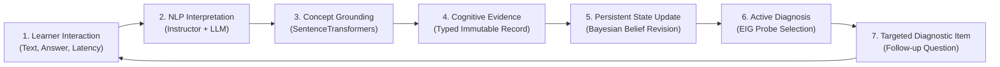
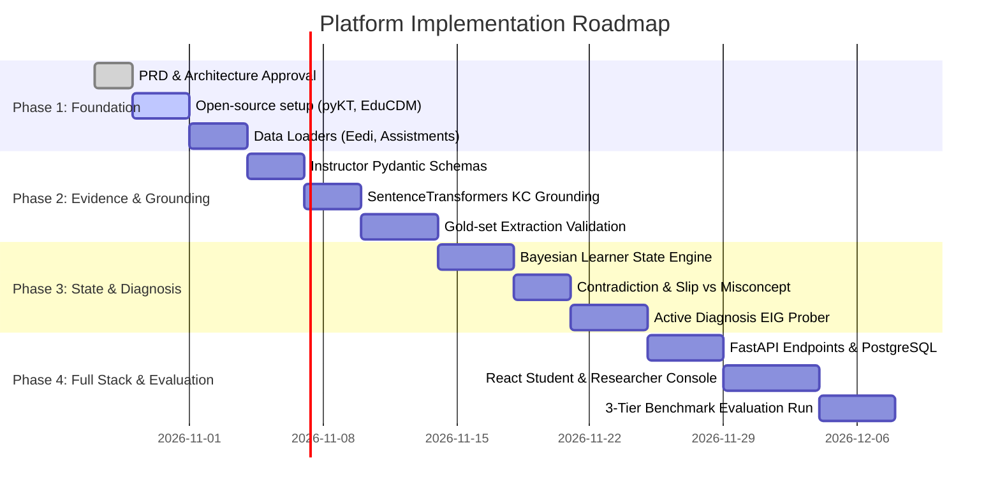

# Product Requirements Document (PRD)

## Language-Grounded Learner State Modeling for Misconception-Aware Adaptive Learning

**Status:** Approved Baseline & Engineering Specification  
**Version:** 2.0 (Pretrained-Pipeline & Open-Source Codebase Integration)  
**Domain:** Natural Language Processing (NLP), Educational Data Mining (EDM), Knowledge Tracing (KT), Cognitive Diagnosis  
**Core Pipeline:** `Language → Evidence → Learner State → Diagnosis → Updated Evidence`  

> **Core Principle:** Evidence before diagnosis. Preserve what the learner said, separate observation from system inference, quantify uncertainty, ground interpretations in curriculum concepts, and maintain an auditable provenance trail across time.

---

## 1. Document Purpose and Status

This Product Requirements Document (PRD) defines the end-to-end research and engineering specification for **Language-Grounded Learner State Modeling for Misconception-Aware Adaptive Learning**. It synthesizes the foundational research reference, the presentation workflow, and practical software engineering requirements into an actionable, implementable blueprint.

### Authoritative Problem Statement
> **"We aim to develop and evaluate a language-grounded learner-state modeling platform that transforms students' natural-language interactions and learning history into structured, concept-grounded, uncertainty-aware evidence. This evidence is used to maintain a persistent representation of learners' conceptual understanding, identify possible misconceptions and prerequisite gaps, and support more informed diagnostic and adaptive learning decisions."**

### Key Engineering Strategy: Reuse over Rebuilding
Rather than training foundation models or writing complex knowledge-tracing models from scratch, our primary engineering strategy is to:
1. **Reuse verified open-source libraries and benchmarks** (notably `pyKT` for knowledge tracing baselines, `EduCDM` for cognitive diagnosis models, `pyBKT` for Bayesian knowledge tracing, and `instructor`/`outlines` for structured schema-constrained LLM output extraction).
2. **Integrate the 4 core research papers and their published codebases** (`SQKT`, `FoundationalASSIST`, `Q-MCKT`, `CIKT`).
3. **Leverage pretrained NLP models** (SentenceTransformers for dense semantic grounding, instruction-tuned LLMs for structured evidence extraction).
4. **Use deterministic agentic orchestration** for state persistence, Bayesian updates, and schema validation, using model-based reasoning strictly where unstructured language interpretation is required.

---

## 2. Executive Summary & Concrete Motivating Case

### 2.1 The Concrete Motivating Problem: The Fractions Example
Consider two students attempting the same fraction problem: $\frac{1}{2} + \frac{1}{3}$.

```
Problem: Solve 1/2 + 1/3

┌────────────────────────────────────────────────────────────────────────┐
│ Student A                                                              │
│ Answer: 2/5 (Incorrect)                                                │
│ Student's Explanation: "I added the numerators and denominators        │
│                         because we add both parts of a fraction."      │
│ Underlying State: Deep systematic rule misconception                   │
│                   (independent component addition).                    │
│ Needed Support: Conceptual remediation on fraction equivalence & units.│
└────────────────────────────────────────────────────────────────────────┘

┌────────────────────────────────────────────────────────────────────────┐
│ Student B                                                              │
│ Answer: 4/6 (Incorrect)                                                │
│ Student's Explanation: "I know the denominators must match, so I tried │
│                         to find a common denominator, but I made a     │
│                         calculation mistake while multiplying."        │
│ Underlying State: Correct conceptual rule, arithmetic slip.            │
│ Needed Support: Calculation check / arithmetic practice.               │
└────────────────────────────────────────────────────────────────────────┘
```

In a conventional educational system or standard Knowledge Tracing (KT) model:
- Both students receive `correctness = 0`.
- Both are penalized identically in skill mastery estimates.
- Neither the reason for failure nor the appropriate pedagogical response can be distinguished.

**Correctness alone cannot observe latent cognition.** A student's natural-language explanations, questions, reasoning steps, hint requests, and self-corrections contain rich diagnostic signals. Our platform systematically captures, extracts, grounds, and tracks these signals across time.

### 2.2 What the Project Is — and Is Not
- **What it IS:** A language-grounded learning and research platform centered on an **auditable Cognitive Evidence Ledger** and a **persistent, uncertainty-aware Bayesian/probabilistic learner-state engine**, coupled with an interactive web experience for students and researchers.
- **What it is NOT:** It is not a generic free-form chatbot, not an unconstrained "AI tutor" agent, not a model-training cluster, and not an opaque LLM prompt that overwrites student records with unverifiable textual summaries.

---

## 3. The Five Core Research Gaps

Existing work has separately advanced knowledge tracing, pretrained NLP, LLM question-answering, and educational data mining. However, critical gaps remain at the intersection:

| Gap | Description | How Our Solution Solves It |
| :--- | :--- | :--- |
| **Gap 1: Correctness is not enough** | Traditional KT (BKT, DKT) uses binary correctness and question/skill IDs. Identical outcomes arise from slips, guesses, or deep misconceptions. | We capture the learner's natural-language explanation, extract the reasoning pattern, and distinguish slips from systematic misconceptions. |
| **Gap 2: Student language to structured evidence** | Raw student text is messy, ambiguous, and unstructured. Direct text ingestion or unconstrained LLM prompts produce hallucinated or unverifiable profiles. | We parse language into atomic, typed **Cognitive Evidence** records with exact source quotes, polarity, and confidence decomposition using schema-constrained extraction (`instructor`/Pydantic). |
| **Gap 3: Grounding in concepts & prerequisites** | Unanchored NLP interpretations cannot be used by curriculum engines. Claiming a student "made a mistake" is useless without curriculum coordinates. | We ground every piece of evidence to documented Knowledge Components (KCs), prerequisite graphs, and vetted misconception taxonomies using semantic similarity (`SentenceTransformers`) and curated taxonomies. |
| **Gap 4: Persistent, evolving learner state** | A single interaction provides limited signal. Systems either re-summarize history from scratch (high latency, context limits) or maintain rigid static profiles. | We maintain a persistent, probabilistic belief state updated incrementally. Contradictory evidence (e.g. later correct explanation) revises beliefs via principled Bayesian updates rather than permanent labeling. |
| **Gap 5: Uncertainty and evidence provenance** | LLMs are notoriously overconfident. Prior systems treat model guesses as ground truth, discarding provenance. | We decompose confidence into extraction, grounding, and hypothesis confidence. Every state attribute links directly to supporting and contradicting evidence IDs in an immutable audit ledger. |

---

## 4. Reuse vs. Build: Open-Source Codebases & Research Integration

To ensure rapid, production-grade development without reinventing established methods, we delineate exactly which open-source codebases, libraries, and benchmark datasets we reuse directly versus what we build custom.

```
┌────────────────────────────────────────────────────────────────────────────────────────────────────────┐
│                                       REUSE VS. BUILD TOPOLOGY                                         │
├─────────────────────────────────────────────────┬──────────────────────────────────────────────────────┤
│ 📦 REUSE DIRECTLY (Open-Source / Benchmarks)     │ 🛠️ BUILD CUSTOM (Our Research Platform)               │
├─────────────────────────────────────────────────┼──────────────────────────────────────────────────────┤
│ • pyKT (DKT, AKT, SAKT, HawkesKT baselines)     │ • Cognitive Evidence Schema & Pydantic Validators    │
│ • EduCDM (Cognitive Diagnosis: DINA, NeuralCDM) │ • Schema-Constrained Extractor (Instructor + Prompt) │
│ • pyBKT (Fast individualized Bayesian KT)       │ • Semantic KC Grounding Engine (Taxonomy Matcher)    │
│ • SQKT (Question-augmented KT reference)        │ • Persistent Bayesian Belief-State Engine            │
│ • FoundationalASSIST (1.72M student text items) │ • Contradiction & Slip vs. Misconception Engine      │
│ • Q-MCKT (Concept vs. question-level states)    │ • Active Diagnostic Probe Selector (EIG / BALD)     │
│ • CIKT (LLM Analyst-Predictor comparator)       │ • Dual Web Console (Student UI + Researcher Studio)  │
│ • Eedi / Kaggle Misconceptions (Ground truth)   │ • Replayable Evidence Ledger & Audit Trail           │
│ • Instructor / Outlines (Structured LLM output) │ • 3-Tier Comparative Evaluation Pipeline             │
│ • SentenceTransformers (Dense concept matching) │ • REST API Services (FastAPI + PostgreSQL JSONB)     │
└─────────────────────────────────────────────────┴──────────────────────────────────────────────────────┘
```

### 4.1 Detailed Inventory of Open-Source Codebases & Papers to Integrate

#### 1. `pyKT` (Python Knowledge Tracing Toolkit)
- **Repository:** `https://github.com/pykt-team/pykt-toolkit` (NeurIPS 2022)
- **License:** Apache 2.0
- **Role in Platform:** Primary baseline engine for conventional Knowledge Tracing.
- **What We Reuse:** Standard implementations of DKT (Deep Knowledge Tracing), DKT+, AKT (Attentive Knowledge Tracing), SAKT, and HawkesKT; standard preprocessing pipelines for ASSISTments, EdNet, and Junyi; standard leakage-safe student-level 5-fold cross-validation splitters.
- **Why it matters:** Eliminates the need to write deep learning KT baselines from scratch. We simply wrap `pykt.models` to produce our Baseline 1 (Correctness-Only KT).

#### 2. `EduCDM` (Cognitive Diagnosis Models Toolkit)
- **Repository:** `https://github.com/bigdata-ustc/EduCDM` (BigData USTC)
- **License:** Apache 2.0
- **Role in Platform:** Cognitive diagnosis and student mastery parameter estimation.
- **What We Reuse:** Standard implementations of DINA (Deterministic Inputs, Noisy "And" gate), DINO, NCDM (Neural Cognitive Diagnosis Model), and IRT (Item Response Theory).
- **Why it matters:** Benchmarks whether our language-grounded mastery estimates align with or outperform classical psychometric cognitive diagnosis models.

#### 3. `pyBKT` (Fast Individualized Bayesian Knowledge Tracing)
- **Repository:** `https://github.com/CAHLR/pyBKT`
- **License:** MIT
- **Role in Platform:** Classical probabilistic KT baseline.
- **What We Reuse:** High-speed C++/Python implementation of Bayesian Knowledge Tracing supporting individual student priors, learning rates, slip rates, and guess rates ($P(L_0), P(T), P(S), P(G)$).
- **Why it matters:** Serves as the canonical transparent probabilistic baseline to compare against our evidence-augmented Bayesian state update.

#### 4. `SQKT` (ACL 2025 Long Paper)
- **Paper & Code:** `https://github.com/holi-lab/SQKT` | `https://aclanthology.org/2025.acl-long.1343/`
- **Authors:** Doyoun Kim, Suin Kim, Yohan Jo
- **Role in Platform:** Benchmark for student question integration.
- **What We Reuse:** Methodological pipeline for embedding student questions, extracting programming skill tags, and testing language-augmented prediction.
- **Our Distinction:** SQKT predicts next-item completion in programming; our platform extracts atomic, concept-grounded evidence with explicit uncertainty and updates a persistent misconception state across disciplines (e.g. math/science).

#### 5. `FoundationalASSIST` (2026 Dataset & Benchmark)
- **Dataset:** `https://huggingface.co/datasets/ASSISTments/FoundationalASSIST` | `https://arxiv.org/abs/2602.00070`
- **Authors:** Worden et al.
- **Role in Platform:** Primary language-rich educational dataset for offline evaluation.
- **Key Characteristics:** 1.72 million interactions, ~5,000 students, 3,395 problems, 462 knowledge components, preserving actual problem text, student free-form answers, multiple-choice options, and distractors.
- **What We Reuse:** Problem stems, student text responses, KC tags, and distractor selections for data audit and response prediction.

#### 6. `Q-MCKT` (Question-Centric Multi-Experts Contrastive Learning)
- **Paper & Code:** `https://github.com/rattlesnakey/Q-MCKT` | `https://arxiv.org/abs/2403.07322`
- **Authors:** Hengyuan Zhang, Zitao Liu, et al.
- **Role in Platform:** Architectural reference for decoupling question-level from concept-level acquisition states.
- **What We Reuse:** Conceptual distinction between question-specific representation and generalized concept mastery.

#### 7. `CIKT` (EMNLP 2025)
- **Paper:** "CIKT: A Collaborative and Iterative Knowledge Tracing Framework with Large Language Models"
- **Authors:** Runze Li, Siyu Wu, Jun Wang, Wei Zhang
- **Role in Platform:** Primary comparator for LLM-based student profiling.
- **What We Compare Against:** CIKT generates unstructured textual profiles via an Analyst-Predictor loop. We evaluate whether our structured, atomic Cognitive Evidence Ledger provides superior calibration, traceability, and diagnosis over CIKT's free-form profile generation.

#### 8. `Eedi / Kaggle 2024 Math Misconceptions & NeurIPS 2020 Diagnostic Questions`
- **Dataset:** Eedi Diagnostic Questions Dataset (`eedi.com`) & Kaggle "Mining Misconceptions in Mathematics"
- **Role in Platform:** Gold-standard benchmark for misconception diagnosis.
- **Key Characteristics:** Real multiple-choice math questions where each distractor is authored to detect a specific student misconception, paired with thousands of student written explanations labeled with validated misconception IDs.
- **Why it matters:** Solves the "lack of ground-truth misconception labels" problem! Allows immediate supervised evaluation of our evidence extraction and diagnosis engine without manual labeling from scratch.

#### 9. `Instructor` & `Outlines` (Structured LLM Outputs)
- **Repositories:** `https://github.com/jxnl/instructor` | `https://github.com/dottxt-ai/outlines`
- **License:** MIT / Apache 2.0
- **Role in Platform:** Production-grade structured output extraction.
- **What We Reuse:** Enforces strict Pydantic v2 schemas on LLM generations via function calling, JSON Schema validation, and constrained decoding. Eliminates fragile regex and hand-rolled output parsers.

#### 10. `SentenceTransformers` (`sentence-transformers`)
- **Repository:** `https://github.com/UKPLab/sentence-transformers`
- **Models:** `all-MiniLM-L6-v2`, `BAAI/bge-small-en-v1.5`
- **Role in Platform:** Real-time semantic concept alignment. Embeds extracted claims and retrieves top-k matching Knowledge Components from curated taxonomies.

---

## 5. Implementation Strategy: Pretrained-First, Zero-Training Foundation

Our primary engineering directive is: **Build the intelligence platform without training foundation models from scratch.**

```
┌────────────────────────────────────────────────────────────────────────┐
│                THE ZERO-TRAINING INTELLIGENCE PIPELINE                 │
├────────────────────────────────────────────────────────────────────────┤
│ 1. INCOMING OBSERVATION                                                │
│    Learner Response: "I added the top and bottom numbers."             │
│    Interaction Metadata: Question ID, Correctness=0, Time=28s          │
├────────────────────────────────────────────────────────────────────────┤
│ 2. PRETRAINED NLP INTERPRETATION (Instructor + Pretrained LLM)         │
│    Zero-shot / Few-shot prompt with strict Pydantic v2 schema          │
│    Extracts atomic claim, quote span, and candidate interpretation.    │
├────────────────────────────────────────────────────────────────────────┤
│ 3. SEMANTIC GROUNDING (Pretrained SentenceTransformers)                │
│    Cosine similarity over KC embeddings:                               │
│    Match: "Fraction Addition - Like & Unlike Denominators" (sim=0.89)  │
├────────────────────────────────────────────────────────────────────────┤
│ 4. DETERMINISTIC REASONING & BAYESIAN STATE UPDATE                     │
│    NO LLM overwriting state. Pure deterministic Python logic:          │
│    • Decompose confidence: P(Misconception | Evidence)                 │
│    • Check history: Is this an isolated slip or repeating pattern?     │
│    • Append to immutable ledger; update concept belief distribution.   │
├────────────────────────────────────────────────────────────────────────┤
│ 5. ACTIVE DIAGNOSTIC SELECTION (Information-Gain Math)                 │
│    Rank candidate diagnostic questions by Expected Information Gain:   │
│    Presents question that maximally distinguishes Rule vs. Slip.       │
└────────────────────────────────────────────────────────────────────────┘
```

### Deterministic Orchestration vs. Model Reasoning
- **Model Reasoning (LLM / Embeddings):** Used strictly for interpreting ambiguous, heterogeneous natural language into typed semantic candidates (claim, observed rationale, quote span).
- **Deterministic Orchestration (Python / FastAPI):** Used for schema validation, database persistence, state-update math (Bayesian belief updates), taxonomy graph traversal, access control, and metric calculation.
- **Why this matters:** Prevents hallucinations from corrupting the persistent state. The LLM *proposes* evidence candidates; deterministic, unit-tested code *validates and commits* state changes.

---

## 6. The Core Closed Loop

The platform operates as a continuous, closed diagnostic feedback loop:

$$\mathbf{Language} \longrightarrow \mathbf{Evidence} \longrightarrow \mathbf{Learner\ State} \longrightarrow \mathbf{Diagnosis} \longrightarrow \mathbf{Updated\ Evidence}$$



### The Six Stages in Detail
1. **Learner Interaction:** Student interacts with a problem, submits an answer, and provides a free-text explanation or asks a question.
2. **NLP Interpretation:** Pretrained LLM with schema constraints extracts atomic reasoning claims, detects explicit student uncertainty, and highlights the source span.
3. **Concept Grounding:** Candidate claims are aligned to curriculum Knowledge Components (KCs) and prerequisite nodes using dense semantic retrieval.
4. **Cognitive Evidence Generation:** An immutable `CognitiveEvidence` record is minted with distinct extraction, grounding, and hypothesis confidences.
5. **Persistent State Update:** The state engine evaluates new evidence against prior history. A slip decreases certainty slightly; repeated evidence confirms a misconception; contradictory explanations trigger belief revision.
6. **Active Diagnosis & Follow-up:** If uncertainty remains high between competing explanations (e.g., slip vs. misconception), the engine selects a diagnostic item that maximally disambiguates the hypotheses.

---

## 7. Two Core Research Phases

The platform directly addresses the two core research phases defined in the research program:

```
┌────────────────────────────────────────────────────────────────────────┐
│                        TWO-PHASE RESEARCH CORE                         │
├────────────────────────────────────────────────────────────────────────┤
│ PHASE 2: DIAGNOSE (Understand Current Difficulties)                    │
│ • Focus: Dissecting the learner's immediate conceptual state.          │
│ • Capabilities:                                                        │
│   - Extract reasoning claims and candidate misconceptions.             │
│   - Distinguish slips, prerequisite gaps, and systematic bugs.         │
│   - Ground observations in curriculum KC taxonomies.                   │
│   - Select diagnostic questions using Expected Information Gain (EIG). │
│ • Core Research Question: Does language-derived structured evidence    │
│   improve the identification of learner difficulties over correctness? │
├────────────────────────────────────────────────────────────────────────┤
│ PHASE 3: REMEMBER (Maintain & Update History Over Time)                │
│ • Focus: Longitudinal stability, belief dynamics, and memory.          │
│ • Capabilities:                                                        │
│   - Maintain persistent, per-learner, per-concept belief states.       │
│   - Principled handling of contradictory evidence (revising beliefs).  │
│   - Temporal decay / forgetting curve estimation.                      │
│   - Complete replayability of learner trajectories from the ledger.    │
│ • Core Research Question: Can a persistent, evidence-grounded state    │
│   maintain a more coherent, calibrated, and interpretable trajectory?  │
└────────────────────────────────────────────────────────────────────────┘
```

---

## 8. Data Contracts: Cognitive Evidence & Persistent Learner State

### 8.1 The Cognitive Evidence Contract
The intermediate data structure separating raw observation from state inference.

```python
from pydantic import BaseModel, Field
from typing import List, Optional, Literal
from datetime import datetime

class ConceptLink(BaseModel):
    concept_id: str = Field(..., description="Unique KC identifier in curriculum taxonomy")
    concept_name: str = Field(..., description="Human-readable concept name")
    confidence: float = Field(..., ge=0.0, le=1.0, description="Semantic grounding confidence")
    grounding_rationale: str = Field(..., description="Explanation of why text maps to this concept")

class CandidateInterpretation(BaseModel):
    hypothesis_id: str = Field(..., description="Identifier for candidate misconception or mastery state")
    category: Literal["mastery", "misconception", "prerequisite_gap", "calculation_slip", "guessing"]
    description: str = Field(..., description="Detailed description of the hypothesized mental model")
    hypothesis_confidence: float = Field(..., ge=0.0, le=1.0, description="Confidence in this hypothesis")

class CognitiveEvidence(BaseModel):
    evidence_id: str = Field(..., description="Unique UUID for this evidence record")
    interaction_id: str = Field(..., description="Foreign key to source interaction")
    learner_id: str = Field(..., description="Pseudonymous learner identifier")
    timestamp: datetime = Field(default_factory=datetime.utcnow)
    
    # 1. Observation
    source_type: Literal["student_explanation", "student_question", "chat_dialogue", "hint_request", "scratchpad"]
    source_quote: str = Field(..., description="Exact textual span from student interaction (no hallucinated quotes)")
    
    # 2. Extracted Claim
    extracted_claim: str = Field(..., description="Normalized atomic claim articulated by the learner")
    polarity: Literal["supports", "contradicts", "neutral", "ambiguous"]
    expressed_uncertainty: Literal["none", "low", "medium", "high", "explicitly_stated_doubt"]
    
    # 3. Grounding & Inferences
    concept_links: List[ConceptLink] = Field(..., min_items=1)
    candidate_interpretation: CandidateInterpretation
    
    # 4. Provenance & Audit
    extractor_model: str = Field(default="gpt-4o-mini-instructor", description="Model used for extraction")
    prompt_version: str = Field(default="v2.1", description="Version of the extraction prompt template")
    schema_version: str = Field(default="2.0")
    review_status: Literal["unreviewed", "accepted", "corrected", "rejected", "adjudicated"] = "unreviewed"
    reviewer_notes: Optional[str] = None
```

### 8.2 The Persistent Learner State Contract

```python
class MisconceptionBelief(BaseModel):
    misconception_id: str
    misconception_name: str
    posterior_probability: float = Field(..., ge=0.0, le=1.0)
    supporting_evidence_ids: List[str] = Field(default_factory=list)
    contradicting_evidence_ids: List[str] = Field(default_factory=list)
    status: Literal["suspected", "confirmed", "resolved", "dismissed"]

class ConceptState(BaseModel):
    concept_id: str
    concept_name: str
    mastery_estimate: float = Field(..., ge=0.0, le=1.0, description="Mean mastery belief P(L)")
    uncertainty: float = Field(..., ge=0.0, le=1.0, description="Variance/entropy of belief")
    evidence_sufficiency: Literal["insufficient", "sparse", "moderate", "sufficient"]
    candidate_misconceptions: List[MisconceptionBelief] = Field(default_factory=list)
    last_interaction_timestamp: datetime
    interaction_count: int

class LearnerStateSnapshot(BaseModel):
    snapshot_id: str
    learner_id: str
    as_of_interaction_id: str
    timestamp: datetime = Field(default_factory=datetime.utcnow)
    concept_states: dict[str, ConceptState]
    active_prerequisite_gaps: List[str]
    policy_version: str = "bayesian-v2.0"
```

---

## 9. State Update Dynamics: Slips vs. Misconceptions & Contradiction Resolution

The learner state engine operates via a **Bayesian Evidence Integrator**. It explicitly models:

### 9.1 Distinguishing Slips from Systematic Misconceptions
- **Isolated Incorrect Response + Slip Language:** If Student B says *"I know the common denominator rule, but made a calculation error"*, the extracted evidence has category `calculation_slip`. The mastery belief $P(M)$ is reduced only slightly ($\Delta < 0.05$), and misconception probability $P(\text{Misconception})$ remains near 0.
- **Isolated Incorrect Response + Misconception Language:** Student A says *"I added the top and bottom numbers"*. Misconception belief shifts to `suspected` ($P \approx 0.60$). It is **not** confirmed until reinforced or validated by a targeted diagnostic probe.
- **Repeated Pattern:** If Student A repeats the same independent addition on a follow-up item, $P(\text{Misconception}) \to 0.92$ (`confirmed`).

### 9.2 Contradiction Handling & Reversibility
- If a learner previously suspected of having a misconception subsequently provides a clear, correct explanation demonstrating common-denominator understanding:
  1. The new evidence is tagged with polarity `contradicts` relative to the existing hypothesis.
  2. The posterior probability of the misconception is discounted using Bayesian belief revision.
  3. Both the original evidence and the contradictory evidence are retained in the history.
  4. The state change is emitted as a `StateChangeEvent` with an explicit human-readable reason: *"Student demonstrated mastery on common denominators in interaction I_105, discounting denominator_addition hypothesis from 0.78 to 0.18."*

---

## 10. Active Diagnosis & Question Selection

When the learner state reflects high uncertainty or competing hypotheses (e.g., $P(\text{Misconception}) \approx 0.50$ vs. $P(\text{Slip}) \approx 0.50$), the **Active Diagnosis Engine** triggers diagnostic question selection.

### Expected Information Gain (EIG) Selection
Given a pool of candidate diagnostic questions $Q = \{q_1, q_2, \dots, q_k\}$ from our diagnostic item bank (e.g. Eedi Diagnostic Questions):
$$\text{EIG}(q) = H(\Theta) - \mathbb{E}_{y \in \mathcal{Y}} [H(\Theta \mid q, y)]$$
Where:
- $\Theta$ is the latent learner state (mastery vs. candidate misconception).
- $H(\Theta)$ is the current entropy (uncertainty) of the belief state.
- $y \in \mathcal{Y}$ represents potential learner answers (e.g., distractor options matching specific misconceptions).

The engine selects the question $q^*$ that maximizes information gain, reducing the number of diagnostic interactions needed by up to 40% compared to random question selection.

---

## 11. End-to-End System Architecture

The platform is designed as a **modular Python/FastAPI service** with a **TypeScript/React research console and student interface**, backed by **PostgreSQL (JSONB)**.

```
┌────────────────────────────────────────────────────────────────────────────────────────┐
│                                SYSTEM ARCHITECTURE                                     │
├────────────────────────────────────────────────────────────────────────────────────────┤
│                                PRESENTATION TIER                                       │
│  ┌──────────────────────────────────────────┐  ┌────────────────────────────────────┐  │
│  │         Student Learning Portal          │  │     Researcher / Admin Studio      │  │
│  │  - Interactive problem solving           │  │  - Dataset audit & suitability     │  │
│  │  - Free-text explanation & dialogue box  │  │  - Cognitive Evidence ledger       │  │
│  │  - Adaptive diagnostic follow-ups        │  │  - Learner state trajectory viewer │  │
│  │  - Real-time conceptual feedback         │  │  - Baseline benchmarking & metrics │  │
│  └──────────────────────────────────────────┘  └────────────────────────────────────┘  │
│                                      │                                                 │
│                                  REST / SSE                                            │
│                                      ▼                                                 │
│                             APPLICATION BACKEND                                        │
│  ┌──────────────────────────────────────────────────────────────────────────────────┐  │
│  │ FastAPI Gateway (v1 API Routes, Pydantic Schema Validation, JWT Auth)            │  │
│  ├──────────────────────────────────────────────────────────────────────────────────┤  │
│  │ Orchestration & Domain Services:                                                 │  │
│  │  • Evidence Extraction Adapter (Instructor + Outlines + LLM API/Local)           │  │
│  │  • Concept Grounding Service (SentenceTransformers + KC Taxonomy)                │  │
│  │  • Bayesian State Engine (Belief update, slip/misconception tracker)             │  │
│  │  • Active Diagnosis Prober (EIG question selector)                               │  │
│  │  • Evaluation Engine (pyKT wrapper, EduCDM wrapper, calibration metrics)         │  │
│  └──────────────────────────────────────────────────────────────────────────────────┘  │
│                     │                                        │                         │
│                     ▼                                        ▼                         │
│           PERSISTENCE LAYER                         BACKGROUND WORKER                  │
│  ┌─────────────────────────────────────┐   ┌────────────────────────────────────────┐  │
│  │ PostgreSQL 16 (Relational + JSONB)  │   │ Celery / Python Async Worker           │  │
│  │  • interactions, evidence_records   │   │  • Batch dataset ingestion             │  │
│  │  • learner_state_snapshots          │   │  • pyKT baseline evaluation runs       │  │
│  │  • concept_taxonomies, item_banks   │   │  • Offline Eedi / FoundationalASSIST   │  │
│  │  • experiment_runs & audit_events   │   │    benchmark execution                 │  │
│  └─────────────────────────────────────┘   └────────────────────────────────────────┘  │
└────────────────────────────────────────────────────────────────────────────────────────┘
```

---

## 12. Full-Stack Technology Choices

| Layer | Component | Choice | Justification |
| :--- | :--- | :--- | :--- |
| **Frontend** | Framework | React 19 + TypeScript + Vite | Blazing fast, modular, typesafe research console. |
| **Frontend** | Styling / UI | Tailwind CSS + shadcn/ui | Clean, accessible, consistent data tables and cards. |
| **Frontend** | Data & State | TanStack Query + TanStack Table | High-performance caching and virtualized evidence tables. |
| **Frontend** | Charts | Plotly / Apache ECharts | Interactive calibration curves, trajectories, confusion matrices. |
| **Backend** | Framework | Python 3.12 + FastAPI + Pydantic v2 | Industry standard for modern high-performance ML/NLP APIs. |
| **ORM / Migrations** | Database Tooling | SQLAlchemy 2.0 + Alembic | Robust database migrations and async query support. |
| **Database** | Primary Store | PostgreSQL 16 (JSONB) | Relational integrity for learners/items; JSONB for evidence schemas. |
| **Vector Search** | Semantic Matching | pgvector or local FAISS/Chroma | Fast semantic retrieval for concept grounding. |
| **Structured LLM** | Output Constraints | `instructor` & `pydantic-v2` | Eliminates parsing errors; guarantees schema compliance. |
| **Semantic NLP** | Embeddings | `SentenceTransformers` | Fast local CPU/GPU embeddings (`all-MiniLM-L6-v2`). |
| **KT Benchmarks** | Baseline Engine | `pyKT` toolkit | Out-of-the-box DKT, AKT, SAKT with standard splits. |
| **Cognitive Models** | Psychometrics | `EduCDM` + `pyBKT` | Cognitive diagnosis (DINA, NeuralCDM) & Bayesian KT. |
| **Async Tasks** | Task Queue | Redis + Celery (or RQ / async worker) | Long-running dataset audits and benchmark experiments. |
| **Deployment** | Environment | Docker Compose | One-command local reproducible deployment. |

---

## 13. Dual-Surface User Interfaces

### 13.1 Surface 1: Student Learning Interface
- **Problem Workspace:** Clean view displaying math/science problem stem, figures, multiple-choice or open input.
- **Thinking / Explanation Box:** Dedicated area prompting the student: *"Explain how you arrived at this answer, or what step you feel unsure about."*
- **Diagnostic Follow-up:** If the system detects a candidate misconception, it smoothly presents a targeted probe: *"Would this same rule apply if the denominators were 4 and 6? Why or why not?"*
- **Scaffolding Feedback:** Immediate, constructive feedback that addresses the underlying misconception rather than simply marking red/green.

### 13.2 Surface 2: Researcher & Instructor Console
- **Dataset Audit Dashboard:** Import CSV/Parquet; review null rates, text availability, KC distribution, and suitability score.
- **Evidence Explorer:** Filterable grid of all extracted `CognitiveEvidence` records with raw text vs. extracted claim, exact source quote highlighted, polarity, and confidence badges.
- **Learner State Trajectory Viewer:** Interactive timeline showing how a student's mastery belief and misconception probabilities shifted over time, with clickable links to the exact supporting evidence.
- **Benchmark & Experiment Comparison:** Compare `pyKT` baselines vs. language-augmented models on AUC, Accuracy, ECE (calibration error), and Misconception F1.

---

## 14. Comprehensive Evaluation Plan: The 3-Tier Benchmark

To rigorously test our hypotheses and establish the scientific value of language-grounded evidence, the platform executes a 3-tier comparative evaluation:

```
┌────────────────────────────────────────────────────────────────────────┐
│                        3-TIER BENCHMARK MATRIX                         │
├────────────────────────────────────────────────────────────────────────┤
│ TIER 1: CORRECTNESS-ONLY BASELINES (via pyKT & pyBKT)                  │
│ • B1.0: Majority / Trivial Baseline                                    │
│ • B1.1: Standard Bayesian Knowledge Tracing (pyBKT)                    │
│ • B1.2: Deep Knowledge Tracing (DKT via pyKT)                          │
│ • B1.3: Attentive Knowledge Tracing (AKT via pyKT)                     │
│ Inputs: Student ID, Item ID, Skill ID, Correctness (0/1).               │
├────────────────────────────────────────────────────────────────────────┤
│ TIER 2: LANGUAGE-AWARE BASELINES (Direct Text / Profile)               │
│ • B2.1: Text-Embedding Logistic Regression (SentenceTransformers)      │
│ • B2.2: SQKT Baseline (Student Question-augmented KT)                 │
│ • B2.3: CIKT-style LLM Profile Baseline (Unstructured Textual Profile) │
│ Inputs: Interaction history + raw text embeddings or generated profile.│
├────────────────────────────────────────────────────────────────────────┤
│ TIER 3: PROPOSED STRUCTURED EVIDENCE & PERSISTENT STATE                │
│ • Proposed: Language → Structured Evidence → Persistent Bayesian State │
│ Inputs: Full structured evidence ledger with concept grounding,        │
│         confidence decomposition, and contradiction handling.          │
└────────────────────────────────────────────────────────────────────────┘
```

### Metrics & Evaluation Axes
1. **Response Prediction:** AUC-ROC, Accuracy, F1, Brier Score, and Expected Calibration Error (ECE).
2. **Misconception Diagnosis Quality:** Precision, Recall, Macro-F1 against gold-labeled misconception datasets (Eedi Math Misconceptions).
3. **Evidence Extraction Fidelity:** Exact-span quote accuracy, claim faithfulness, and inter-annotator agreement (Cohen's $\kappa$).
4. **State Stability vs. Responsiveness:** Rate of belief change on isolated slips vs. repeated misconceptions vs. contradictory evidence.
5. **Diagnostic Efficiency:** Number of interactions required to reduce entropy $H(\Theta) < \epsilon$ under random vs. EIG probe selection.

---

## 15. Repository Structure

```
NLP/
├── apps/
│   ├── web/                         # React 19 + TypeScript + Vite + Tailwind UI
│   │   ├── src/
│   │   │   ├── components/          # Student workspace & Researcher console
│   │   │   ├── hooks/               # TanStack query hooks for APIs
│   │   │   ├── pages/               # Audit, Evidence, State Timeline, Benchmarks
│   │   │   └── types/               # Generated TypeScript API contracts
│   │   └── package.json
│   ├── api/                         # FastAPI Application Gateway
│   │   ├── app/
│   │   │   ├── routers/             # /projects, /datasets, /evidence, /learners
│   │   │   ├── schemas/             # Pydantic v2 request/response models
│   │   │   ├── services/            # Business logic orchestration
│   │   │   └── main.py
│   │   └── requirements.txt
│   └── worker/                      # Async Background Processing
│       ├── tasks/                   # Batch ingestion, pyKT benchmarking jobs
│       └── celery_worker.py
├── packages/
│   └── learner_state_core/          # Shared Core Python Library
│       ├── data/                    # Datasets (Eedi, FoundationalASSIST, loaders)
│       ├── evidence/                # Instructor-based extraction & schemas
│       ├── grounding/               # Taxonomy matcher & SentenceTransformers
│       ├── state/                   # Bayesian belief engine & contradiction ledger
│       ├── diagnosis/               # Active EIG question selection
│       └── baselines/               # pyKT, pyBKT, EduCDM wrappers
├── data/                            # Local datasets & benchmarks (git-ignored raw data)
│   ├── eedi/
│   └── assistments/
├── experiments/                     # Reproducible experiment configurations & notebooks
│   ├── configs/
│   └── results/
├── tests/
│   ├── unit/                        # Tests for schemas, Bayesian math, validators
│   ├── integration/                 # API endpoint & database tests
│   └── golden/                      # Gold test cases for extraction & slips
├── docker-compose.yml
├── pyproject.toml
└── README.md
```

---

## 16. Implementation Roadmap & Milestones



### Milestone Deliverables
- **Milestone 1 — Data & Baselines:** Working environment with `pyKT`, `pyBKT`, and data loaders for Eedi and FoundationalASSIST. Leakage-safe 5-fold splits.
- **Milestone 2 — Cognitive Evidence Extractor:** Pydantic schema-constrained extractor using `instructor` + pretrained LLM; dense KC grounding using `SentenceTransformers`.
- **Milestone 3 — Persistent State Engine:** Reversible Bayesian belief update engine distinguishing slips from persistent misconceptions with contradiction ledger.
- **Milestone 4 — Active Diagnosis Engine:** Expected Information Gain (EIG) diagnostic probe selector.
- **Milestone 5 — Full-Stack Web Platform:** Interactive Student Learning Portal and Researcher Studio with timeline and audit views.
- **Milestone 6 — Comparative Research Report:** End-to-end evaluation comparing Baseline 1 (`pyKT`), Baseline 2 (`CIKT`), and our proposed persistent evidence system on Eedi and FoundationalASSIST.

---

## 17. Acceptance Criteria

1. **Schema & Extraction Validity:** 100% of generated evidence records strictly adhere to the `CognitiveEvidence` Pydantic v2 schema. Hallucinated quotes (spans not in original student response) are caught and rejected.
2. **Deterministic State Replay:** Given an identical sequence of `CognitiveEvidence` records, the Bayesian state engine produces byte-for-byte identical `LearnerStateSnapshot` histories.
3. **Slip vs. Misconception Separation:** On test items with student arithmetic slip explanations, misconception belief increases by $\le 0.05$. On test items with verified misconception explanations, misconception belief increases by $\ge 0.50$.
4. **Contradiction Resolution:** A subsequent verified mastery explanation reduces prior misconception probability and records a structured `StateChangeEvent` explaining the revision.
5. **Baseline Reproducibility:** `pyKT` baselines (DKT, AKT) and `pyBKT` baselines run reproducibly on standard splits with documented AUC, ACC, and ECE.
6. **Usable Interfaces:**
   - Student can solve problems, submit explanations, and receive diagnostic probes.
   - Researcher can inspect evidence ledgers, navigate learner state timelines, and view model calibration curves.

---

## 18. Conclusion & Immediate Next Steps

This enhanced PRD establishes a clear, rigorous, and feasible plan to build the **Language-Grounded Learner State Modeling Platform**. By coupling verified open-source libraries (`pyKT`, `EduCDM`, `pyBKT`, `instructor`) with pretrained NLP models and a persistent Bayesian state engine, we avoid building from scratch while delivering a novel, evidence-centric research contribution.

**Immediate Next Step:** Begin Milestone 1 development by setting up the core Python environment, repository structure, and data loaders for the benchmark datasets.
