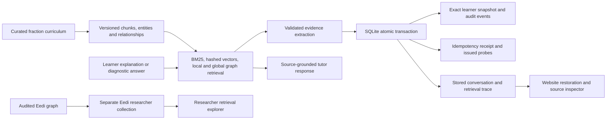

# Retrieval, persistence, and regression implementation report

Branch: `training`. This continuation implements and verifies the existing fraction prototype's live flow. It does not train a new language model or establish educational effectiveness.

## Findings and implementation order

The starting website exposed offline training results but had no persistent retrieval system. Its optional matcher compared claims against four taxonomy entries. Learner writes committed separately, snapshot reads reconstructed new presentation metadata, diagnostic options did not complete a durable answer loop, and chat messages disappeared on reload.

The implementation order was: add a source-index boundary; implement persistent retrieval and source provenance; make the interaction write atomic and retryable; preserve exact evidence and snapshot contracts; connect diagnostic answers and conversation restoration; strengthen extraction and state policy; evaluate retrieval and test the whole browser flow.

## Current architecture



The default extractor and tutor are deterministic. Optional Azure extraction and generation are explicitly selected by environment variables. Hosted generation is not guaranteed reproducible; the committed reply is persisted and returned on retries using the same event key. All provider calls occur before the database state write lock.

## LightRAG concepts applied

[LightRAG's repository](https://github.com/HKUDS/LightRAG) documents entity-oriented local retrieval, relationship-oriented global retrieval, hybrid retrieval, chunk retrieval, and mix mode. Its [paper](https://arxiv.org/abs/2410.05779v3) motivates combining graph structure with retrieval and incremental updates.

This implementation adapts those concepts to the repository's structured curriculum:

| Layer | Implementation |
| --- | --- |
| Sources | Canonical concepts, misconception descriptions, remediation guidance, and prerequisite links; a separate checksum-verified Eedi collection |
| Chunks | Paragraph-preserving chunks with deterministic IDs; long paragraphs use 180-word windows with 24-word overlap |
| Entity and graph index | Persistent SQLite entities and typed `requires`, `associated_with`, and `within_topic` edges |
| Lexical retrieval | SQLite FTS5 BM25, safely quoted query tokens, local normalization of a few fraction terms |
| Vector retrieval | Deterministic normalized hashed lexical features, 4,096 dimensions; these are not trained semantic embeddings |
| Local retrieval | Entity matches and query-ranked source chunks |
| Global retrieval | Bounded graph expansion of up to two relationship hops |
| Fusion | Weighted reciprocal rank fusion; direct lexical/vector ranks dominate graph expansion in mix mode |
| Context | Top-k and character budget, source revision/license/citation IDs, stable tie breaking, explicit abstention |
| Incremental updates | Content/version fingerprints skip unchanged sources; replacement and deletion remove stale chunks, FTS rows, entities, and edges atomically |
| Integrity | Index fingerprints, source provenance, pinned Eedi checksums, separate collections, persisted retrieval traces |

This is a domain-specific implementation inspired by LightRAG. The `lightrag-hku` runtime is not installed. There is no generative graph extraction, neural embedding model, learned reranker, or distributed graph database in this branch.

## Indexed data

The app curriculum has **10 documents/chunks, 10 entity records, and 10 relationships**. Live extraction and tutoring use this collection.

The Eedi researcher collection has **10,375 documents/chunks, 12,633 entity records, and 21,552 relationships**. Entity records include repeated topic declarations across source documents; they are not a count of unique concepts. The relationships comprise 19,294 released misconception-to-construct links and 2,258 construct-to-topic links. The source revision is `2ae0839debf73c0ce7dd6578d8ea8b99e7be8631`.

Attribution: “Eedi Misconceptions Graph v1.0” by Eedi, licensed under CC BY 4.0. The original dataset has no learner response labels and no reviewed crosswalk to this app's concept IDs. Eedi retrieval is therefore available to researchers without creating learner diagnoses or altering the live taxonomy.

The SQLite indexes and raw downloaded data remain local and Git-ignored. The branch tracks the indexer, source adapter, aggregate [index audit](experiments/retrieval_index_audit.json), and evaluation artifacts. Learner evidence is never inserted into the public curriculum index.

## Durable interaction contract

1. Validate concept IDs, input bounds, diagnostic issuance, and the event key.
2. Retrieve curriculum sources and extract evidence. Rule evidence IDs/timestamps derive from the interaction. Optional generated evidence must pass exact-quote and canonical-taxonomy checks; invalid output falls back to rules.
3. Open a SQLite `BEGIN IMMEDIATE` transaction. Check the event key again under the database write lock.
4. Apply the evidence to the persisted prior state. Write the interaction, complete evidence JSON, complete snapshot JSON, audit events, retrieval trace, issued/answered probe state, conversation turn, and response receipt as one transaction.
5. Commit all parts, or roll all of them back. A matching retry returns the stored response; reusing the key with different input returns HTTP 409.

The browser retries a transport failure or server error once using the **same** event key. The regression suite simulates a response lost after the server commits and checks that one learner update exists afterward.

Full snapshot JSON preserves snapshot IDs, timestamps, prerequisite gaps, state policy, candidate provenance, and informative-evidence counts. Full evidence JSON preserves prompt/schema/review fields, explicit counterevidence targets, and retrieval citations. Full audit-event JSON preserves snapshot links, uncertainty, and candidate-score changes.

Existing databases are migrated additively. When a preexisting snapshot uses an older state policy, it becomes an explicit replay baseline before the first new event. Historical rows remain available; replay reports how many earlier records belong to the preserved baseline. Missing metadata that the old database never stored cannot be reconstructed exactly.

## Evidence, state, and diagnosis corrections

- Verbatim evidence means an exact source substring, including punctuation and mathematical signs. Fabricated generated quotes fall back to rules.
- Negated rules, guessing, missing explanations, and conflicting correctness/reasoning cues trigger cautious interpretation.
- Each of the four curriculum concepts has its own supported rule patterns; unknown concept IDs are rejected.
- A correct answer choice alone remains ambiguous reasoning evidence. Repeated guesses do not create sufficient reasoning evidence.
- Counterevidence names the candidate hypotheses it refutes. Unrelated or inactive candidate scores are preserved.
- State weights remain hand-set and uncalibrated. Beta masses and candidate scores are not fitted cognitive probabilities.
- Diagnostic likelihoods are normalized across options before computing expected entropy; the item bank validates option uniqueness and exactly one correct answer.
- Diagnostic answers are scored from the **issued diagnostic item**, associated with its learner and parent interaction, and persisted through the same pipeline. Invalid, cross-learner, or already answered probe submissions are rejected. Previously answered item IDs are excluded from later selection.
- Fraction scoring no longer has a hard-coded list of “correct” options. Unsupported expressions return unknown correctness.
- Saved conversation history restores after reload and learner switching. The source inspector shows the retrieved curriculum context. “Clear View” clears the visible stream without promising deletion of stored history.

## Retrieval evaluation

[Evaluation cases](experiments/retrieval_cases.json) contain **12 authored development/regression queries**: ten in-scope and two out-of-scope. These cases were used while improving ranking; they are not an independent held-out benchmark.

| Mode | Mean recall@3 | MRR@3 | Top-1 relevant | Out-of-scope abstention |
| --- | ---: | ---: | ---: | ---: |
| Naive chunks | 0.80 | 0.80 | 0.80 | 1.00 |
| Local | 0.85 | 0.80 | 0.70 | 1.00 |
| Global | 0.85 | 0.80 | 0.70 | 1.00 |
| Hybrid | 0.85 | 0.80 | 0.70 | 1.00 |
| Mix | 0.80 | 0.80 | 0.80 | 1.00 |

All modes returned identical results on repeated queries and resolved their returned citation IDs to source context in this small set. Those checks do not measure answer faithfulness or source relevance on an external corpus. The graph did not improve mix mode's relevance score over naive retrieval on these cases. The full [machine-readable evaluation](experiments/retrieval_evaluation.json) retains every query, retrieved document IDs, metric definitions, corpus fingerprint, and measured latency.

A smoke query against the full Eedi collection returned pinned, attributed fraction construct sources. It is a functional check, not a relevance benchmark. Vector scoring currently scans a collection and was not load-tested at a larger scale.

## Evaluation flow and regression coverage

| Feature | Verification |
| --- | --- |
| Training results API | Aggregate metrics, all tracked artifact checksums, launch-directory independence, missing and malformed reports |
| Data ingestion and splits | Existing ASSISTments/MAP/Eedi tests, reproducible fixture conversion, local RNG, invalid ratios, disjoint learner splits |
| BKT and metrics | Existing fit/evaluation coverage, serial fitting, explicit prediction-column requirement, undefined single-class AUC, ECE boundary validation |
| Retrieval | All five modes, graph prerequisites, source citations, repeat/restart consistency, context budget, no-match and adversarial input, collection isolation |
| Index lifecycle | Idempotent updates, changed source fingerprints, complete stale-source deletion, transaction rollback, old-index version rejection/recovery |
| Evidence | All four concepts, exact quotes, negation/guessing/conflicts, deterministic IDs and timestamps, invalid optional-provider output |
| State | Existing slip/misconception/reversal cases, explicit candidate counterevidence, inactive candidate preservation, guessing sufficiency |
| Persistence | Exact snapshot/evidence/event round trips, restart recovery, stale-candidate removal, legacy replay baseline, learner-data cleanup |
| Event processing | Concurrent database initialization, concurrent retries apply once, distinct concurrent events are retained, key conflicts, injected event-write rollback, learner isolation |
| Diagnosis | Normalized likelihoods, bounded EIG, empty/excluded item banks, issued-item scoring, duplicate and cross-learner rejection |
| Conversation | Stored turns/citations, provider failure fallback, stable retry response, reload and learner switching |
| Website | Browser flows across Lab, tutor, training, retrieval explorer, ledger, trajectory/replay, dataset audit, synthetic benchmark, mobile error state |
| Retry after lost response | Browser intercept commits first request, drops its response, and verifies the retry uses the same key and creates one evidence record |

The synthetic benchmark was rerun with the v3 evidence/state policy. Tier 3 now has AUC **0.5938**, accuracy **0.6667**, and binary misconception F1 **0.5000** on generated templates. This is a software demonstration. The benchmark now explicitly identifies the different current-response and next-response tasks across tiers. The ASSISTments real-data training metrics and model checkpoints are unchanged.

## Verification result

The full Python suite passed **102 tests**, with 32 existing pyBKT/NumPy deprecation warnings. **Six Playwright browser tests passed**, including the lost-response retry. TypeScript checking, the Vite production build, Python compilation, and patch whitespace checks passed. These verify software behavior, not educational validity. Optional Azure calls were stubbed during tests.

## Reproduce

```bash
.venv/bin/python -m pytest -q
npm run build --prefix apps/web
npm run test:e2e --prefix apps/web
.venv/bin/python experiments/evaluate_retrieval.py
.venv/bin/python experiments/index_retrieval_corpus.py --include-eedi
.venv/bin/python experiments/run_benchmark.py
```

Playwright requires its Chromium installation (`cd apps/web && npx playwright install chromium`). Its backend runs with a temporary database on port 8013 and its frontend on 5193. Regular Vite development uses port 5173 and an API proxy to 8001; set `API_PROXY_TARGET` when that port belongs to another application.

## Remaining limits

This is still a fraction research prototype. MAP data authorization and a trained response classifier remain absent. The state transition weights and diagnostic likelihoods need reviewed longitudinal data. The Eedi-to-app crosswalk needs expert validation. Retrieval needs independently labeled relevance queries, a semantic embedding/reranking ablation, faithfulness evaluation, and larger-scale latency/load tests. Hosted Azure behavior was tested with controlled stubs, not live paid calls. Authentication and authorization for learner records are not implemented, so the current learner switcher is a local demonstration interface rather than a multi-tenant security boundary.
