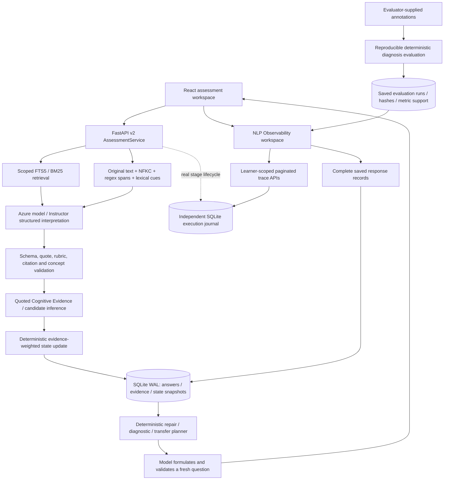

# NLP Concepts Applied in the Language-Grounded Learner State Modeling Platform — Implementation and Technical Justification Report

Date: 1 November 2026. Scope: the current v2 assessment application, with explicit distinctions for legacy v1 research code. All source paths below are relative to the repository root. This report accompanies working software and recorded executions; it is not an independent NLP demonstration.

## 1. Executive summary

The platform studies whether what learners write supplies evidence about conceptual understanding that correctness marks alone miss. Its research object is a persistent, revisable learner representation. The implemented workflow is learner explanation → quoted Cognitive Evidence → constrained concept association → validated inference → deterministic state computation → atomic persistence → diagnosis-driven question planning.

The selected NLP methods are Unicode normalization, original-text token/sentence spans, lexical frequency and cue extraction, lexical retrieval using FTS5/BM25 with Porter stemming, and model-assisted structured semantic interpretation. Deterministic code validates quotations, rubric partitions, concept identities and reference provenance. It updates evidence-weighted Beta parameters and candidate misconceptions without letting tutor coaching count as learner evidence.

NLP Observability adds an actual execution journal, live polling, historical inspection, technique-to-source links, text transformations, evidence inspection and state comparisons. Failed attempts and failed persistence are recorded. There are no fabricated dependency trees, embeddings, similarity values, calibrated confidences or research improvements.

The repository's research reference and PRD were reviewed before implementation. The attachment is an implementation specification; no separate slide deck/presentation file exists in this workspace. The root research reference is therefore the available research authority. No claim is made to have inspected an unavailable slide deck.

## 2. End-to-end architecture and existing-project audit



### 2.1 Existing functionality and changes

| Area | Inspection result | Implemented extension |
|---|---|---|
| Frontend/navigation | React 19/Vite, existing light indigo workspace, chat, inspector and reports | NLP Observability sidebar item; navigation remains available during inference; original draft stays in parent state |
| Backend | FastAPI v2 invokes `assessment/service.py`; v1 compatibility API remains | Read-only trace/history/research endpoints; no duplicate NLP service |
| NLP | `assessment/nlp.py` already computed text views and lexical cues | Mathematical symbols/decimal spans retained; newline sentence loss and decimal splitting fixed; actual results journalled |
| Inference | `assessment/provider.py` uses existing Azure deployment + Instructor/Pydantic | Real call attempts, prompt-contract IDs, model deployment ID and returned usage exposed through stages |
| Orchestration | Sequential service orchestration with bounded retries; no autonomous multi-agent runtime | Named component lifecycle records; no invented agent actions |
| Grounding | Saved question target constrains concept ID in a generated topic map | Accepted concept, candidate set, prerequisites and unverified taxonomy provenance inspected |
| State | Weighted Beta update, criterion gaps, duplicate damping and explicit contradictions | State before/after, math, belief changes and committed revision visible in trace |
| Persistence | SQLite WAL, thread-local nesting, immutable snapshots, idempotency and optimistic checks | Additive execution/stage/evaluation tables; original records preserved |
| Existing observability | Successful answer/question summaries only | Independent ordered stages record running/success/failure, safe errors and retries |
| Research | Legacy 48-record artifact and experiment code; no validated v2 study | Honest score matrix; supplied-annotation evaluation runner; no baseline improvements manufactured |
| Deployment/security | Local loopback, browser profile identifier, no production identity provider | Every new record lookup scopes to learner; sensitive config/private answers omitted; original local security boundary remains explicit |

The pre-implementation map is in `docs/superpowers/plans/2026-11-01-nlp-observability.md`. Existing uncommitted application changes were preserved. No learner database was reset or seeded.

### 2.2 Persistence and trace contracts

`nlp_executions` stores execution ID, ordinal, learner/session/question identity, operation, lifecycle timestamps, final status, duration and references. `nlp_stages` stores monotonically ordered stage IDs, previous/parent IDs, actual inputs/outputs, technique, implementation, configuration, attempt, duration and safe error codes. Nested generation executions link to their parent execution. An answer's `extraction_trace.trace_id`, evidence `trace_id`, evidence `source_interaction_id`, turn ID and state snapshots form the provenance chain.

The journal opens its own short SQLite connection. A persistence span encloses the learner transaction in an order that commits/rolls back the transaction before the span records completion/failure. Computed state is explicitly uncommitted until persistence succeeds. If telemetry writes fail, the learner pipeline continues; missing events remain missing rather than being filled with invented success. A process crash can leave `running` records, which the UI explicitly identifies as possibly interrupted.

Payload limits are 160 list elements/dictionary fields, depth 12, 12,000 characters per string and a 192 KB stage payload budget. Omitted information is labelled. **Saved responses** retrieves/exports the full underlying answer record on demand, including complete token/state arrays. Private reference answers and current question criteria are omitted from traces; historical answered question records follow the existing report contract.

Raw trace retention defaults to 30 days via `NLP_TRACE_RETENTION_DAYS`; pruning runs when executions begin and when traces are read. Deleting trace records cascades to their stages, not to learner evidence/state. This is opportunistic cleanup while the app is used, not a continuously running background deletion service or secure disk erasure policy.

### 2.3 Interfaces

| Interface | Purpose |
|---|---|
| `GET /api/v2/observability/traces` | Learner scope; conversation/question/operation/status filters; bounded limit; ordinal cursor; actual overview totals |
| `GET /api/v2/observability/traces/{trace_id}` | Ordered actual stages and completion/interruption information |
| `GET /api/v2/observability/records` | Paginated saved responses, including pre-tracing records |
| `GET /api/v2/observability/records/{turn_id}` | Complete original answer/evidence/state record within learner scope |
| `GET /api/v2/observability/techniques` | Registry of techniques linked to current implementation locations |
| `GET /api/v2/observability/research?run_id=...` | Operational measurements, selected annotation evaluation, six hypotheses and historical artifact caveats |
| `experiments/evaluate_assessment_annotations.py` | Compute and persist a diagnosis evaluation from actual saved responses and supplied labels |

## 3. Complete syllabus concept-to-implementation matrix

**Status legend:** Used = actually executed in v2; Partial = relevant concept handled by constrained model interpretation, without a dedicated linguistic algorithm; Legacy = implemented outside the current v2 UI; Rejected = considered and not selected; Future = justified only with new data/evaluation. A pretrained model's internal machinery is not counted as a separately implemented local algorithm.

To keep the full matrix readable, `A/` below means `packages/learner_state_core/assessment/`. Tests refer to repository `tests/`. The evidence column distinguishes executed code/tests from methods considered only.

| NLP concept | Implemented? / status | Application location | Stage | Actual implementation | Input | Output | Purpose | Research relevance | Alternatives | Selection justification | Evidence |
|---|---|---|---|---|---|---|---|---|---|---|---|
| A: NLP / NLU / semantic interpretation | Yes, Used | `A/provider.py:evaluate` | extraction | Pretrained structured model + saved rubric | Current explanation, question, retrieved context | Quoted claim/category/criterion judgments | Interpret variable learner language | Language-derived evidence beyond correctness | Regex-only baseline | Handles paraphrase and context; requires expert validation | Live trace; conversation tests |
| A: NLG | Yes, Used | `A/provider.py:generate_question` | generation | Model formulation under saved deterministic plan | Plan/state/source passages | Fresh question + private rubric | Produce a targeted diagnostic check | Supports later diagnostic investigation | Fixed item bank in legacy code | Preserves existing dynamic workflow; no learning-gain claim | Browser check; generation validation stages |
| A: Pragmatic/discourse interpretation | Partial | `A/service.py` / `provider.py` | retrieval/extraction | Saved historical evidence + model context | Prior state and current response | Context-dependent interpretation | Interpret ambiguity/contradictions | Persistent evidence versus isolated answers | Dedicated discourse parser | Limited to model context; no annotated discourse tree | Contradiction tests; no separate parser claimed |
| A/E: Morphological/syntactic analysis | No, Rejected as dedicated stages | No active v2 module | None | None | None | None | Not needed by current rubric contract | No demonstrated incremental gain | Lemmatizer/POS/parser | Would add labels without a validated downstream consumer | Repository inspection |
| B: Text normalization / cleaning | Yes, Used | `A/nlp.py:normalize` | preprocessing | Python NFKC + whitespace regex | Original Unicode response | Separate normalized view | Stable comparison/retrieval features | Original evidence stays unchanged | Aggressive punctuation/negation removal | Symbols and negation have educational meaning | Raw-text and math tests |
| B: Regex extraction / preprocessing pipeline | Yes, Used | `A/nlp.py:analyze` | preprocessing | Unicode-aware regex span and cue extraction | Original response | Tokens, sentences, cues, offsets | Inspectable features | Evidence offsets and informativeness | spaCy/NLTK pipelines | Small deterministic contract; no model download | `test_nlp_observability.py` |
| C: Custom word/number/symbol tokenization | Yes, Used | `A/nlp.py:analyze` | preprocessing | Regex spans in original text | Response | Tokens + start/end code-point offsets | Keep math and punctuation visible | Transparent representations and source linkage | NLTK/spaCy tokenization | No dependency overhead; explicit math handling | Math-span regression; live trace |
| C: Sentence tokenization | Yes, Used | `A/nlp.py:analyze` | preprocessing | Boundary regex preserving newlines/decimals | Response | Original sentence spans | Segment readable evidence | Demonstrate actual transformations | Pretrained sentence model | Lightweight; known abbreviation limitations remain | Newline/decimal regression |
| C: BPE/subword tokenization / OOV vocabulary | No local implementation; not applicable | Provider internals inaccessible | None | Model's internal tokenizer not exposed | No local subword input | No claimed local pieces/OOV IDs | Avoid false representation claims | Honest observability | Model tokenizer SDK | A deployment alias does not specify an inspectable tokenizer | Technique page explicitly states absence |
| D: Stop-word handling | Yes, Used narrowly | `A/nlp.py:STOP_WORDS`, `search_terms` | lexical features/retrieval | Custom English keyword exclusion | Normalized lexical tokens | Ranked keywords / FTS query terms | Reduce lexical query noise | Retrieve relevant evidence | No filtering; multilingual list | Does not delete words from learner text or semantic-model input; negation separately retained | NLP output and source code |
| D: Porter stemming | Yes, Used in retrieval | `A/storage.py:install_schema` | retrieval | FTS5 `porter unicode61` | Indexed chunks and FTS queries | Stemmed lexical matching/BM25 results | Match English inflections | Retrieve earlier evidence/source passages | Lemmatization/FastText | Bundled SQLite implementation, no downloaded model | Actual retrieval ranks/methods; FTS5 source |
| D: Lancaster/Snowball/standalone Porter and lemmatization | No, Rejected in v2 preprocessing | No module | None | None | None | None | Avoid distorting symbols/technical terms | No validated benefit over existing retrieval | POS-aware lemmatization | FTS stemming already serves the limited retrieval role | Inspection; not inferred from installed packages |
| E: POS/Penn Treebank/default/regex/unigram/bigram/trigram/affix/Brill/perceptron taggers | No, Rejected | No active tagger | None | None | None | No POS tags | No downstream tag-dependent feature | Research tests concern claims/concepts, not POS | spaCy/perceptron tagger | No gold tag-dependent task or evaluated improvement | No POS stage displayed |
| E: Dependency parsing / visualization | No, Future only if justified | No active parser | None | None | None | No dependency graph | Potential scope/negation research | Needs annotated failure analysis first | Model interpretation, rule cues | A decorative parse does not validate a diagnosis | No dependency view claimed |
| F: Structured information / claim extraction | Yes, Used | `A/provider.py`, `models.py`, `service.py` | extraction/evidence | Instructor + Pydantic + exact quote validation | Current explanation | `ExtractedObservation` / evidence | Make inferred claims inspectable | Core Cognitive Evidence contribution | Rule extraction | Model handles language; deterministic contract enforces provenance | Real evidence JSON, fabricated-quote rejection |
| F: NER / NLTK/spaCy NER / EntityRuler / phrase/entity matching | No, Rejected as entity algorithms | No active entity pipeline | None | None | None | No general named entities | Concepts are not ordinary person/place entities | Assigned concept IDs are grounded separately | Domain phrase matcher | General NER does not identify misconception semantics reliably | Grounding stage identifies its actual constraint method |
| F: Batch processing | No dedicated live batch NLP; evaluation batches records | `A/evaluation.py` | offline evaluation | Deterministic loop over persisted records | Labelled record IDs | Saved evaluation run | Reproducibility | Enables expert evaluation | Streaming inference batches | Interactive learner flow needs short per-answer execution | Annotation evaluator tests |
| G: Unigram frequency | Yes, Used as lexical frequency only | `A/nlp.py:analyze` | preprocessing | `collections.Counter` | Normalized lexical tokens | Up to 16 keyword features | Query formation/inspection | Transparent evidence retrieval | TF-IDF weights | Small scoped retrieval does not need learned language probabilities | Actual keyword list |
| G: Bigrams/trigrams/ngram LMs/sentence probability/zero-frequency/Laplace/next-word prediction | No, Rejected/not applicable | No active ngram LM | None | None | None | No sentence probabilities | Project is diagnosis, not word completion | Avoid unrelated syllabus demonstrations | Pretrained language model | No task requiring trained ngram distribution | Absence explicitly documented |
| H: Vocabulary / sparse term representation / document ranking | Yes, Used internally by FTS5 | `A/storage.py:retrieve` | retrieval | Unicode61/Porter inverted index + BM25 | Scoped query + saved chunks | Actual matches, ranks and fallback mode | Retrieve supporting sources | Source-grounded interpretation and history | Count/TF-IDF cosine/dense retrieval | Local, transparent, operationally small | Retrieval stage JSON; SQLite FTS5 |
| H: CountVectorizer/explicit BoW/document-term matrix | No dedicated v2 matrix | None | None | No exported DTM | None | None | Not required for current retrieval | Possible baseline, not learner state | FTS5 index | Do not claim FTS5 as an executed sklearn CountVectorizer | Source inspection |
| H: TF-IDF / cosine / direct text classification | TF-IDF Yes, Legacy experiment only; cosine not v2 | `experiments/run_benchmark.py` | offline legacy tier 2 | sklearn `TfidfVectorizer` + logistic regression | Legacy sample explanations | Current-answer classification | Transparent text baseline | Requires matched future experimental design | BM25 or embeddings | Do not add redundant TF-IDF to the working v2 pipeline | Legacy script/artifact; non-comparable flag |
| I: SVD/TruncatedSVD/LSA/PCA/t-SNE/latent variance | No, Rejected/Future | No active transform | None | None | None | No projection | Visualization without task benefit would mislead | Future retrieval ablation only | Sparse ranking | No evaluated high-dimensional corpus problem here | No plotted latent dimensions claimed |
| J: Word2Vec/CBOW/Skip-Gram/windows/negative sampling/vector arithmetic/loss | No, Rejected | No training code in active path | None | None | None | No trained vectors/loss | No word embedding training task | Would require a substantial suitable corpus | Pretrained sentence encoder | Small project data cannot justify custom embedding training | No training/similarity stage |
| K: GloVe/co-occurrence/target-context pairs/pretrained GloVe | No, Rejected | No active module | None | None | None | No co-occurrence matrix/vectors | Not needed for rubric-grounded evidence | Static vectors lose important contextual distinctions | Contextual model/lexical retrieval | Additional model assets without evaluated benefit | Inspection |
| L: FastText/character ngrams/OOV vectors/rare misspellings | No, Future conditional | No active module | None | None | None | No subword vectors | Possible lexical-recall improvement | Must evaluate misspelling retrieval failures | Character retrieval / encoder | Model can interpret some misspellings; no robustness claim without evaluation | Misspelling transport test is not FastText validation |
| M: Doc2Vec/tagged documents/clustering/K-Means/PCA/semantic search | No, Rejected/Future | No active Doc2Vec pipeline | None | None | None | No learned document vectors/clusters | Not needed for small scoped corpus | Possible retrieval study later | BM25 / sentence embeddings | Additional training/clustering is not required for evidence lineage | No clustering shown |
| C/H: Sentence/document embeddings and cosine similarity | Yes, Legacy optional implementation, not current v2 | `grounding/matcher.py:SemanticTaxonomyMatcher` | Unused by v2 | Optional all-MiniLM-L6-v2 or lexical overlap fallback | Claim/taxonomy descriptions if explicitly called | Ranked legacy concept links | Older concept matcher | Potential future retrieval/grounding ablation | Assigned-concept constraint | Existing class/library installation is not proof of current execution | Call-site inspection; v2 trace has no embedding stage |
| N: spaCy blank/pretrained/custom pipeline/token attributes/Matcher/PhraseMatcher/EntityRuler/multilingual classifier | No, not selected | No active spaCy imports/pipeline | None | None | None | No spaCy annotations | Custom spans cover current need | Any addition needs evaluation | Current regex + structured model | No superficial pipeline solely for demonstration | Technique registry contains actual methods only |

## 4. Layer-by-layer technical justification

### 4.1 Input and preprocessing

Pydantic request models reject blank/oversized responses and invalid identifiers before the service begins. Successful request validation is recorded as an input stage; rejected HTTP request bodies are not retained in the trace journal. Original learner input is never replaced by normalized text. NFKC and whitespace normalization produce a separate view. NFKC may expand compatibility symbols such as vulgar fractions; the original is the authoritative quotation/offset source. See the [Python Unicode normalization documentation](https://docs.python.org/3/library/unicodedata.html).

Custom token spans preserve numbers, decimal numbers, mathematical operators, punctuation and contractions. Offsets are Python Unicode code points, not JavaScript UTF-16 positions or provider subword offsets. Sentence spans preserve original text and no longer drop newline-terminated lines or split inside decimal numbers. This remains a heuristic sentence segmenter, not a trained syntactic model; abbreviations and mathematical punctuation can still be ambiguous.

Casefolding feeds keyword/cue extraction; it does not overwrite evidence. Stop words are omitted only from keyword/query features. In particular, negation remains in the full response sent to interpretation, and explicit negation/uncertainty cues are separately retained. Those regex cues are not themselves a semantic diagnosis. The response fingerprint preserves case while normalizing whitespace, so repeated evidence can be damped without conflating case-sensitive equations/code.

### 4.2 Retrieval and representation

Source documents are chunked with overlapping original character ranges. Study notes, model-authored reference and learner evidence have distinct source kinds. Retrieval is scoped to the exact learner/topic and separates learning material from historical learner evidence. FTS5 uses `porter unicode61`, and BM25 supplies lexical ranking. Smaller SQLite BM25 ranks sort first; ranks are not confidence probabilities. When no terms match, a recent scoped fallback is recorded explicitly. Study-note precedence has its own documented fallback.

This is a real lexical representation, not a dense embedding or manually exposed document-term matrix. TF-IDF and dense retrieval are credible alternatives for a future controlled comparison. Adding them as unused visual stages would obscure rather than strengthen the experiment. [SQLite FTS5 documents its tokenizers and BM25 behavior](https://www.sqlite.org/fts5.html).

### 4.3 Semantic extraction and grounding

`AssessmentProvider.evaluate` receives the saved question/rubric, current response, prior state and retrieved material. It extracts a verbatim source quotation, short claim, category, criterion partition, possible misconception, contradiction references, citations and feedback. The model may interpret paraphrases, slips or ambiguity; these remain interpretations requiring expert assessment. No hidden reasoning chain is recorded or claimed.

Grounding accepts only the saved question's concept ID and resolves it against the persisted topic map. The trace shows the candidate set, accepted concept, prerequisites and `model_authored_topic_map_unverified`. This is constrained association, not open-domain concept recognition. A generated acyclic graph is structurally valid but its prerequisite relationships have not been independently expert-validated.

### 4.4 Validation and Cognitive Evidence

`ExtractedObservation` enforces structured shape. Deterministic checks verify exact quotation membership and span sufficiency, disjoint/full rubric partition, allowed source citations, existing contradiction identities and category consistency. Invalid evidence triggers a bounded retry; failure of both attempts returns an error with no state update. Pydantic validates data contracts, not educational truth; this distinction follows [Pydantic's model documentation](https://pydantic.dev/docs/validation/latest/concepts/models/).

The evidence inspector separates the learner quotation from extracted claim and candidate category/misconception. Each final record carries question, session, turn, trace, evidence and timestamp identity. Confidence is explicitly uncalibrated. Exact quotations prove where the text came from, not that the model understood it correctly.

### 4.5 State computation, persistence and diagnosis

The existing criterion-weighted rule computes `w = confidence × novelty × min(tokens/16, 1)`. Coverage is met criteria divided by all rubric criteria. Alpha receives `w × coverage`; beta receives `w × (1 − coverage)` with the existing slip discount. Ambiguous/low-confidence/very short evidence holds numerical estimates. Duplicate response weight is damped. Missing skills persist until that exact skill is explicitly rechecked. Hypotheses retain supporting and contradicting evidence IDs; validated later contradiction weakens the relevant score.

The state stage records actual before/after values and factors, not a hardcoded favorable example. The separate persistence stage applies optimistic conversation/snapshot checks and commits answer, evidence chunk, state revision and conversation together. A rollback remains visible as failed persistence and computed-but-unconfirmed state.

The planner then reads saved state and chooses diagnose/repair/verify-hypothesis/transfer intent, target concept and task kind. The model formulates a question; deterministic checks verify target, citations, required criteria and novelty. This is an implemented heuristic policy, not measured expected information gain. Failure to generate a valid follow-up preserves the saved answer and exposes the existing retry action.

## 5. Recorded live execution walkthrough

The detailed, machine-derived walkthrough is appended below under **Recorded execution evidence**. It comes from actual UI submissions through FastAPI, the configured live provider and a temporary SQLite database. The learner identity and response are synthetic verification inputs. They are not real student research data, and the execution does not establish diagnostic accuracy or learning gains. Both fixture and live execution artifacts explicitly carry `is_research_evaluation: false`.

## 6. Pretrained model and library justification

Versions below were inspected in the verification environment; Python dependencies are specified as minimums in `pyproject.toml`, whereas frontend exact versions resolve through `package-lock.json`. Reproducing research across installations requires pinning the environment and model deployment revision as well as saving run hashes.

| Dependency / model | Verified version / identity | Role and resource rationale | Alternatives and license/source |
|---|---|---|---|
| Azure pretrained model | Configured deployment `gpt-4.1-mini`; exact underlying model revision not captured | Topic map, structured interpretation and question formulation; cloud latency dominates observed execution | Larger pretrained model/rules-only extractor. Model access follows service terms; model weights are not bundled or claimed open source |
| OpenAI Python SDK | 2.16.0 | Existing Azure transport, timeout and usage metadata | Direct HTTP would duplicate client/error handling; [Apache-2.0 source license](https://github.com/openai/openai-python/blob/main/LICENSE) |
| Instructor | 1.17.0 | Existing schema-guided structured outputs | Direct JSON schema handling; [MIT source license](https://github.com/567-labs/instructor/blob/main/LICENSE) |
| Pydantic | 2.12.5 | Request/output constraints and deterministic structural validation | Handwritten validators would duplicate schema definitions; [MIT source license](https://github.com/pydantic/pydantic/blob/main/LICENSE) |
| FastAPI | 0.136.1 | Existing HTTP contracts and validation | Other frameworks offer no relevant gain; installed package license is MIT |
| SQLite | 3.49.1 in verification Python | Local WAL transactions, FTS5, history and trace journal; no external queue/service needed | Remote relational DB for deployed multi-user operation; [public-domain source](https://www.sqlite.org/copyright.html) |
| Python Unicode/regex/Counter | Existing Python 3.12 environment | Small deterministic preprocessing; no model downloads | spaCy/NLTK if future error analysis justifies complexity; Python PSF license |
| React / Vite / TypeScript | Existing project lockfile | Incumbent UI, polling, cancellation, accessible native controls | Preserve existing stack; package licenses in lockfile |
| scikit-learn | 1.7.1 | Existing legacy TF-IDF/logistic baseline and baseline tests; not current live extraction | No new model training added; BSD-3-Clause |
| sentence-transformers | Declared dependency; not executed by v2 | Optional legacy matcher only | Do not infer pretrained embedding use from installation; any future model must record revision/license separately |
| Playwright | 1.60.0 in verification environment | Optional desktop/mobile browser checks; not a runtime NLP dependency | Manual browser testing is less reproducible; Apache-2.0 |

No custom Word2Vec, GloVe, FastText, Doc2Vec or language model was trained. The project does not have a validated training corpus supporting that expansion. The provider's subword pieces and model internals are not available from this integration; returned usage counts are recorded when supplied, and no monetary cost is invented from unavailable pricing/account data.

## 7. Orchestration justification

This is service orchestration, not a collection of autonomous educational agents. The model handles open-ended language interpretation/formulation, where variability warrants it. Deterministic code handles graph validation, quotation/reference checks, state arithmetic, transaction isolation, IDs, event persistence and metric calculation.

The current provider uses temperature 0.2, Instructor `max_retries=1` and the configured Azure client's 20-second timeout / SDK retries disabled. Service-level evidence and generation loops have at most two attempts. The trace records observed application attempts rather than fabricating SDK-internal request counts. See [Instructor's retry documentation](https://python.useinstructor.com/concepts/retrying/) for the distinction between inference requests and extraction attempts. Token usage is stored if returned; missing usage remains unavailable.

Known validation failures are recorded using an allowlist of safe codes. Provider exception bodies, credentials and endpoint configuration are not stored. Retry feedback identifies the failed deterministic check without including secrets. There is no canned-question or invented-evidence fallback in v2. Legacy v1 retains its existing conservative rule fallback; the current UI does not present that as v2 model execution.

The observer's polling failure does not interrupt learner computation. Requests are abortable on navigation; polling has bounded exponential backoff and no overlapping loop. A refresh can recover saved-response reads after an outage. Histories predating instrumentation show their real saved summaries with no manufactured stage timings.

## 8. Research deliverables, scores and hypothesis matrix

### 8.1 What is actually measured

The live/fixture browser artifacts record actual processing and database values. Python tests validate quotation integrity, rollback, idempotency, contradiction updates, live running visibility, scoped access and concurrent updates. Operational quote integrity and state/evidence linkage are calculated directly over saved learner records. These are engineering integrity measurements, not expert semantic faithfulness or research effectiveness scores.

`evaluation.py:evaluate_annotations` evaluates actual saved responses against evaluator-supplied annotations. It saves dataset/source identity, annotation hash, record hashes, extractor models, exact predictions, per-class precision/recall/F1, concept/category accuracy and optional expert faithfulness judgments. Binary misconception F1 requires positive gold misconception labels. Each metric reports its eligible-label denominator. Supplied annotation provenance is retained but not independently certified. Future prediction/calibration are not inferred from diagnosis scores.

No expert-labelled v2 research dataset is included or invented. No run is seeded in the user's database. The CLI is fully usable when labels are supplied:

```powershell
python experiments/evaluate_assessment_annotations.py --learner-id YOUR_ID --annotations labels.json
```

```json
{
  "dataset": "Your independently annotated subset and version",
  "annotation_source": "Annotator and protocol version",
  "annotations": [
    {
      "turn_id": "an actual saved turn identifier",
      "category": "partial",
      "concept_id": "the expert-assigned concept identifier",
      "misconception_present": false,
      "claim_faithful": true
    }
  ]
}
```

This JSON specifies the annotation format, not a fabricated evaluation dataset. The script refuses missing/foreign records and duplicate annotation IDs.

### 8.2 Score matrix and baseline boundaries

| Dimension | Metric | Correctness baseline | Text baseline | Proposed | Evidence/status |
|---|---|---|---|---|---|
| Future prediction | AUC / log loss | Not evaluated for v2 | Not evaluated for v2 | Not evaluated | Requires matched task horizons and held-out future responses |
| Diagnosis | Category precision/recall/F1, concept accuracy | Pending | Pending | Computable from supplied annotation runs | No expert-label results seeded |
| Diagnosis | Binary misconception precision/recall/F1 | Pending | Pending | Conditional on positive gold labels | Not misconception-identity F1 |
| Evidence | Expert claim faithfulness | Pending | Pending | Conditional on supplied expert judgments | Exact quote integrity is a separate operational metric |
| Longitudinal state | Brier / ECE / future prediction | Pending | Pending | Not evaluated | Alpha/beta and hypothesis scores are heuristic and uncalibrated |
| Operations | Quote integrity / saved state linkage | Not applicable | Not applicable | Measured on real saved records | Verification artifacts show actual denominators; not learning gains |
| Adaptation | Information gain / questions to resolution | Random/fixed/prerequisite comparisons pending | Not applicable | Not evaluated | Current question policy is heuristic |
| Learning outcomes | Retention / transfer improvement | Control study required | Control study required | Not evaluated | Requires suitable participants/design and outcomes |

The existing `experiments/benchmark_results.json` contains 48-record legacy measurements: correctness-only AUC 0.9062, direct-text AUC 1.0000 and persistent-state AUC 0.4688. They are displayed only as a historical artifact with a checksum and caveats. The text baseline sees the current explanation whereas the state tier predicts before seeing it. Their horizons differ. The loader creates a synthetic sample when no external dataset path is given; a dataset name alone does not establish that this is a representative external Eedi study. The artifact lacks exact run/dataset-version provenance. Its improvement deltas are not used as validated v2 evidence. No scientific conclusion follows from these numbers.

### 8.3 Six research hypotheses

| Hypothesis | Current capability / NLP stages | Required data and experiment | Baseline / metrics | Tested finding |
|---|---|---|---|---|
| H1: Language adds evidence | Structured extraction and quoted evidence | Human-labelled explanations/correctness, matched held-out task | Correctness-only KT; future AUC/log loss and diagnosis F1 separately | Untested |
| H2: Structure beats raw text | Schema/grounding/state integration | Same labelled partitions; raw-text and structured pipelines | TF-IDF/raw-text classifier; diagnosis metrics | Untested |
| H3: Grounding reduces misreadings | Assigned-concept constraint, explicit provenance | Expert concept/error labels; grounding ablation | Remove grounding; concept accuracy/error analysis | Untested |
| H4: History beats isolated answers | Saved states, evidence retrieval, contradiction links | Time-ordered learner trajectories; stateless ablation | Single-response extraction; future loss/update consistency | Untested |
| H5: Uncertainty reduces overdiagnosis | Ambiguity abstention/holds; uncalibrated confidence display | Gold diagnoses/confidence judgments and abstention protocol | Same pipeline without uncertainty handling; Brier/ECE/coverage | Untested |
| H6: Smarter choice needs fewer questions | Deterministic adaptive planner | Validated earlier stages and controlled selection study | Random/fixed/prerequisite strategies; questions to resolution | Untested; no information-gain implementation in v2 |

## 9. Concepts considered but not selected

TF-IDF is a useful transparent baseline and already exists in the legacy experiment. Adding it beside BM25 in the live path without retrieval evaluation would duplicate functionality. Embeddings could improve paraphrase retrieval but add model/version/resource concerns; they need a gold retrieval set and a leakage-safe comparison. The existing optional MiniLM class is not called by v2.

Word2Vec/CBOW/Skip-Gram/GloVe require suitable corpora and produce static vectors rather than misconception evidence. FastText could help lexical recall for misspellings, but current misspelling tests check preservation and pipeline execution, not validated language robustness. Doc2Vec/clustering have no demonstrated advantage for a small per-learner corpus. LSA/SVD/PCA/t-SNE would be optional analysis rather than central evidence extraction; a visually attractive projection would not establish correct diagnosis.

POS, dependency parsing and generic NER can be useful in other tasks. This application's consumer is a rubric-linked conceptual claim, not a named entity or tag sequence. Their addition should follow an error study identifying a specific downstream improvement. Stop-word removal/stemming are confined to lexical features; the original explanation and negations remain available to semantic interpretation. Ngram sentence probabilities, smoothing and next-word prediction answer different questions from this research objective and are not implemented.

## 10. Verification, limitations and justified improvements

### 10.1 Verified scenarios

| Scenario | Verification source | Interpretation |
|---|---|---|
| Correct explanation, clear incorrect rule, slip wording, vague input, numerical input, math symbols, misspellings | `test_nlp_observability.py` parameterized real API/storage flow | Fixture semantic outputs are controlled inputs; verifies transport, spans, recording and persistence, not model diagnostic accuracy |
| Contradictory evidence and later correct explanation weaken earlier hypothesis | `test_conversation_assessment.py` and persistent pipeline tests | Deterministic state policy verified against controlled evidence |
| Processing failure / invalid structured or fabricated output / retries | Observability and conversation tests | Failed attempts recorded; invalid evidence does not alter state |
| Database persistence failure | Storage-failure test | Answer/evidence/state rollback together; failed persistence trace survives |
| Historical trace and complete older response | Trace/detail and saved-record tests; browser history/reload | Persisted output inspected; old stage events never regenerated |
| Concurrent interactions | Threaded integration test | Distinct executions; optimistic version conflict prevents double commit |
| Observer outage | Telemetry-write failure test; browser records outage/refresh | Learning continues; observer can recover |
| Retention and pagination | Retention/cursor/limit tests | Trace deletion preserves learner records; invalid limits rejected |
| Live visibility | Blocked fixture provider integration test | Running stage is visible before provider returns |
| Actual cloud/application processing | `experiments/verify_nlp_observability.py --live` | Synthetic learner uses real UI/API/model/SQLite; no semantic accuracy benchmark claimed |
| Desktop/mobile, navigation, search, evidence/state views and scope | Browser artifacts | Actual DOM behavior, no JS errors and no mobile document overflow in verified viewport |

Run the suite with `python -m pytest tests -q`, `npm test`, `npm run build`. Optional browser setup is documented in README. Test fixtures and live verification use temporary databases; real learner records are not test fixtures. The repository retains upstream pyBKT/NumPy deprecation warnings and a frontend bundle-size advisory; neither is a failing verification result. These are not claims of load-tested distributed production readiness.

### 10.2 Limits that remain material

1. This remains a local single-user research application. A browser learner identifier is not authentication; multi-user hosting needs real authentication, authorization, per-user rate limits and institution-approved data policy before exposure. Scope checks prevent accidental profile mixing, not a malicious local actor who knows another identifier.
2. Model confidence, evidence weights and hypothesis scores are uncalibrated. Quote/citation validation does not ensure semantic correctness. Supplied source material and generated topic relationships can be wrong.
3. FTS retrieval is lexical. Misspellings/paraphrases can cause recorded recency fallbacks. Stemmed index token internals are not separately exposed as fabricated token arrays.
4. Journal writes are best effort; storage outage/crash can leave incomplete traces. Polling is near-live (1.5 seconds), not a guaranteed event stream. Total execution duration includes nested calls and can exceed sums of visible individual stage durations.
5. Historical records predate stage instrumentation, so only their actual saved summaries/values are inspectable. Expired traces can be unavailable while learner evidence remains retained.
6. Dynamic concept association is question-constrained. A high concept-match score on annotations would not demonstrate unconstrained concept identification. Exact deployed pretrained-model revision and provider-internal retries are not claimed observable.
7. Current annotation evaluation is diagnosis-only and accepts supplied label provenance. H1–H6 comparisons, future prediction, ECE/Brier calibration, information gain, ablations and actual learning outcomes remain unevaluated until appropriate data/studies exist.
8. No clinical, psychometric or educational-validity certification is implied by passing software tests. Heuristic improvements in a state estimate are not proof that a learner learned more.

Useful next work is an expert annotation protocol, matched correctness/text/structured baseline horizons, chronological learner-held-out evaluation, calibration and abstention studies, and validated question-selection comparisons. Add embedding retrieval or linguistic models only if a measured error analysis supports their cost.

## 11. Conclusion and source inventory

The implemented NLP methods serve the actual research workflow: preserve language, extract source-linked claims, constrain concept identity, represent uncertainty and revise persistent state when evidence changes. Observability exposes the real computation and its failures without turning an NLP syllabus into unrelated demonstrations. The working system can now support inspection and the collection of traceable data for research; it does not treat implementation as proof of any hypothesis.

Primary implementation references:

- `apps/web/src/components/assessment/NlpObservability.tsx`, `apps/web/src/api/observability.ts`, `apps/api/app/main.py`.
- `packages/learner_state_core/assessment/{execution,nlp,service,provider,models,storage,state,research,evaluation}.py`.
- `tests/test_nlp_observability.py`, `tests/test_observability_evaluation.py`, existing conversation/persistence tests, `apps/web/tests/observability.test.mjs`.
- `experiments/verify_nlp_observability.py`, `experiments/evaluate_assessment_annotations.py`.
- `docs/verification/nlp-observability/fixture-execution.json` and `docs/verification/nlp-observability/live/live-execution.json`.
- Root research reference, PRD and `docs/LEARNER_STATE_PIPELINE.md` for original intended scope and state formulas.


## Recorded execution evidence (machine-derived appendix)

This section copies an actual saved execution from `docs/verification/nlp-observability/live/live-execution.json`. The input identity is synthetic; inference, transformations, validation, persistence and browser checks actually executed. Re-running the live check may produce different questions and interpretations.

- Trace: `nlp_53a6865737a54fcb89e653ed9998157d`
- Start time (UTC): `2026-11-01T06:34:35.221851+00:00`
- Model deployment: `gpt-4.1-mini`; exact model revision unavailable.
- Conversation: `conversation_7555b588d56846cdade952bfb2fa923f`
- Turn: `turn_e58cfb9edaae42f18167bd2da5cc67b5`
- Question: `question_32eab9234b2444b691ba2ca838ee1ac3`
- Evidence: `evidence_b10d0847ed0c4e288d135cff49ebe3e2`
- Snapshot before: `state_a8dc433dba104f2abae61e299efd878e`
- Snapshot after: `state_184cbdae51764cc0ac4b9926e50b0046`

### Original application question and learner response

**Generated question:** Explain why a fraction represents a ratio of the numerator to the denominator and how this ratio relates to the concept of a part of a whole or a ratio between two quantities. Use an example fraction to illustrate your explanation.

**Submitted response (verbatim synthetic test text):**

> I multiply both numerator and denominator by the same nonzero number, so their ratio stays unchanged. For example, 1/2 = 2/4 because multiplying both parts by two preserves the value; multiplying only the numerator would change it.

### Actual preprocessing and representation

```json
{
  "normalized_text": "I multiply both numerator and denominator by the same nonzero number, so their ratio stays unchanged. For example, 1/2 = 2/4 because multiplying both parts by two preserves the value; multiplying only the numerator would change it.",
  "token_count": 46,
  "keywords": [
    "both",
    "numerator",
    "multiplying",
    "multiply",
    "denominator",
    "same",
    "nonzero",
    "number",
    "ratio",
    "stays",
    "unchanged",
    "example",
    "because",
    "parts",
    "two",
    "preserves"
  ],
  "negation_cues": [],
  "uncertainty_cues": [],
  "response_hash": "99c59e313d45e0494b374f77783356424d1ec51be5b22d26e8a2fdecc6027c2d",
  "version": "unicode-math-spans-v2"
}
```

First 12 actual token spans (complete array is in the artifact/saved response):

| Token | Original start | Original end |
|---|---:|---:|
| `I` | 0 | 1 |
| `multiply` | 2 | 10 |
| `both` | 11 | 15 |
| `numerator` | 16 | 25 |
| `and` | 26 | 29 |
| `denominator` | 30 | 41 |
| `by` | 42 | 44 |
| `the` | 45 | 48 |
| `same` | 49 | 53 |
| `nonzero` | 54 | 61 |
| `number` | 62 | 68 |
| `,` | 68 | 69 |

Retrieval uses actual saved source chunks and ranks:

```json
{
  "query": "Fraction Definition A fraction denotes a ratio of the numerator to the denominator, representing a part of a whole or a ratio between two quantities. ",
  "scope": {
    "learner_id": "verification_synthetic_learner",
    "topic_key": "b0581a2bae10b7a8847a9973d8ed3752627649ac"
  },
  "method": "SQLite FTS5 · Porter/Unicode tokens · BM25",
  "materials": [
    {
      "chunk_id": "chunk_980d8e96f0e247779462dd6c262fad59",
      "source_id": "source_be3083625ecf45f692a48999ccbb2f9c",
      "kind": "study_notes",
      "content": "Equivalent fractions represent the same value. Multiply or divide both numerator and denominator by the same nonzero number. Changing only the numerator usually changes the value. A fraction denotes a ratio of numerator to denominator.",
      "metadata": {
        "start": 0,
        "end": 235,
        "title": "Equivalent fractions · supplied notes"
      },
      "rank": -7.32142857142857e-06,
      "retrieval_method": "fts5_bm25"
    }
  ],
  "evidence": []
}
```

### Actual extracted evidence and validation

```json
{
  "concept_id": "fraction_definition",
  "source_quote": "I multiply both numerator and denominator by the same nonzero number, so their ratio stays unchanged. For example, 1/2 = 2/4 because multiplying both parts by two preserves the value; multiplying only the numerator would change it.",
  "claim": "The fraction represents a ratio between numerator and denominator, and multiplying numerator and denominator by the same number preserves this ratio, illustrating the concept of equivalent fractions.",
  "category": "partial",
  "confidence": 0.7,
  "met_criteria": [
    "understand_ratio",
    "use_example"
  ],
  "missing_criteria": [
    "relate_part_whole"
  ],
  "misconception": null,
  "contradicts_hypothesis_ids": [],
  "feedback": "You show understanding that a fraction represents a ratio and use an example to illustrate equivalent fractions, but you do not explain how the fraction relates to a part of a whole or a ratio between two quantities. Try to include that connection in your explanation.",
  "coaching": "A fraction shows a ratio of the numerator to the denominator, representing how many parts of a whole are taken. For example, 3/4 means 3 parts out of 4 equal parts of a whole. This shows both a ratio and a part of a whole.",
  "source_citations": [
    "chunk_980d8e96f0e247779462dd6c262fad59"
  ],
  "evidence_id": "evidence_b10d0847ed0c4e288d135cff49ebe3e2",
  "question_id": "question_32eab9234b2444b691ba2ca838ee1ac3",
  "timestamp": "2026-11-01T06:34:41.378864+00:00",
  "source_start": 0,
  "source_end": 231,
  "extractor_model": "gpt-4.1-mini",
  "confidence_calibrated": false,
  "trace_id": "nlp_53a6865737a54fcb89e653ed9998157d",
  "source_interaction_id": "turn_e58cfb9edaae42f18167bd2da5cc67b5",
  "session_id": "conversation_7555b588d56846cdade952bfb2fa923f",
  "validation_status": "passed"
}
```

The model returned **partial**, not an automatically successful learning outcome. Its uncalibrated confidence was 0.7. The original response substring at [0:231] equals the recorded quote. Grounding accepted `fraction_definition` from the saved question's concept map; no embedding similarity was calculated.

### Actual numerical update and database outcome

```json
{
  "concept_id": "fraction_definition",
  "rule": "weighted_criterion_update",
  "confidence": 0.7,
  "coverage": 0.6666666666666666,
  "novelty_factor": 1.0,
  "informativeness": 1.0,
  "duplicate_response": false,
  "weight": 0.7,
  "delta_alpha": 0.466667,
  "delta_beta": 0.233333,
  "before_alpha": 1.0,
  "before_beta": 1.0,
  "after_alpha": 1.466667,
  "after_beta": 1.233333,
  "before_estimate": 0.5,
  "after_estimate": 0.54321,
  "delta_estimate": 0.04321,
  "before_uncertainty": 0.28868,
  "after_uncertainty": 0.25897,
  "hypothesis_changes": [],
  "resolved_criteria": [],
  "formula": "w=confidence×novelty×min(tokens/16,1); α′=α+w×rubric_coverage; β′=β+w×(1−coverage)×slip_factor; estimate=α′/(α′+β′)",
  "limitation": "Heuristic evidence estimate, not a calibrated measurement of understanding. Tutor coaching never updates these parameters."
}
```

The saved estimate changed from 0.5 to 0.54321; alpha changed from 1.0 to 1.466667, beta from 1.0 to 1.233333. These are heuristic evidence parameters, not percentages of true understanding or measured learning gains.

The transaction inserted the answer in `assessment_answers`, its evidence chunk in `assessment_chunks`/FTS, the snapshot in `assessment_state_history`, and the topic/conversation update. The final persistence-stage output was:

```json
{
  "turn_id": "turn_e58cfb9edaae42f18167bd2da5cc67b5",
  "evidence_id": "evidence_b10d0847ed0c4e288d135cff49ebe3e2",
  "snapshot_id": "state_184cbdae51764cc0ac4b9926e50b0046",
  "revision": 1,
  "committed": true
}
```

### Actual stage statuses and durations

| Stage | Status | Duration ms |
|---|---|---:|
| Scoped source retrieval | completed | 1.689 |
| Input validation | completed | 0.474 |
| Text transformations | completed | 1.11 |
| Cognitive interpretation | completed | 3197.654 |
| Evidence validation | completed | 0.682 |
| Concept grounding | completed | 0.108 |
| Cognitive Evidence | completed | 0.13 |
| Learner-state computation | completed | 0.713 |
| Atomic persistence | completed | 13.06 |

Returned provider usage (not estimated):

```json
{
  "completion_tokens": 264,
  "prompt_tokens": 3551,
  "total_tokens": 3815,
  "completion_tokens_details": {
    "accepted_prediction_tokens": 0,
    "audio_tokens": 0,
    "reasoning_tokens": 0,
    "rejected_prediction_tokens": 0
  },
  "prompt_tokens_details": {
    "audio_tokens": 0,
    "cached_tokens": 0
  },
  "latency_checkpoint": {
    "engine_tbt_ms": 7,
    "engine_ttft_ms": 43,
    "engine_ttlt_ms": 1795,
    "pre_inference_ms": 100,
    "service_tbt_ms": 7,
    "service_ttft_ms": 177,
    "service_ttlt_ms": 1926,
    "user_visible_ttft_ms": 78
  }
}
```

Linked actual executions:

| Operation | Trace | Status |
|---|---|---|
| generation | `nlp_638ead2bd299445aa66a456c6f6c25e6` | completed |
| answer | `nlp_53a6865737a54fcb89e653ed9998157d` | completed |
| generation | `nlp_a1048c209ee64d1a8cbc020e019b4d56` | completed |
| create | `nlp_bda9cbf9f0984783b0f7e338264f59e8` | completed |

Verification outcome: 11 browser workflow checks passed, 0 JavaScript errors, mobile document overflow = False. The separate fixture browser run also verifies records outage/refresh recovery. These counts are engineering checks, not participant or research sample sizes.
