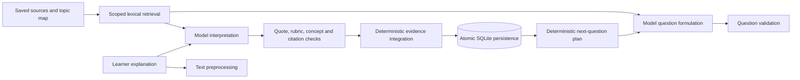

# Assessment workspace and NLP review

Review date: 2 November 2026. Scope: the React learning workspace and the `/api/v2` assessment, persistence and observability pipeline.

## What was wrong and what changed

| Feedback | Finding | Change |
| --- | --- | --- |
| Setup required scrolling | Large introduction, six-row notes field, repeated explanatory copy and generous vertical spacing placed the submit action below the screen. At 1366×768 the page was 1087px tall. | A two-column desktop setup, shorter helper text, compact notes editor and stacked mobile layout. The full setup fits the tested 1366×768, 1280×720, 1024×768 and 390×844 viewports. |
| Assessment components felt difficult to navigate | Question, history, memory and completion actions competed for vertical space. Smaller widths stacked the entire inspector below the conversation. | A viewport-bounded desktop workspace with independently scrollable long content; compact question/composer; completion in the workspace header; explicit Current question / Saved topic memory navigation at narrower widths. History remains expandable. |
| Text transformations seemed inactive | The most recent execution was often question generation, which has no learner text preprocessing. Bounded trace token arrays also include omission markers. | Prefer a learner-response execution when available; explain applicability; provide a route to the latest response. Show original/normalized text, genuine tokens with original offsets, readable lexical features and retrieval details. Load the complete saved response so long token arrays are complete. |
| Cognitive Evidence seemed inactive | Topic setup and generation do not extract learner evidence. Raw JSON and generic unavailable messages did not explain the distinction. | Explain the model/validation boundary; show the verified quote, span, claim, category, confidence and met/missing rubric descriptions. Invalid extraction is never displayed as accepted evidence. |
| State changes seemed inactive | Only learner-response processing computes an update. A computed state can also exist even if persistence fails. | Explain before/after estimates, uncertainty, evidence weight, coverage, duplicates and holds. Distinguish computed output from committed state; retain calculation/state/persistence detail. |

Additional backend fixes: lexical cue matching now handles typographic apostrophes and common negated contractions; raw text and offsets remain intact. Preprocessing is versioned `unicode-math-spans-v3`. An idempotently replayed answer links its trace to the original saved response and original trace, rather than appearing to have missing evidence. Concurrent identical requests also link to the winning saved record, explicitly label discarded computations and never claim a second commit. The responsive Guide reveals each target pane before measuring its highlight. Reading traces, switching tabs and loading complete records never resubmit an answer.

## What actually executes



The model performs interpretation and formulation. Python owns validation, numerical updates, planning and persistence. SQLite owns storage and lexical ranking. The browser displays these results; it does not send chat history as the authoritative learner memory.

### Text processing

1. **Unicode normalization.** `normalize()` applies NFKC and collapses whitespace in a separate view. Compatibility normalization can change a symbol's representation; it must not replace the original text used for evidence. The original response and source documents are preserved. See the [Unicode normalization specification](https://www.unicode.org/reports/tr15/).
2. **Tokenization and offsets.** Regex splits numbers, Unicode letter words/contractions, punctuation and mathematical symbols. Every displayed span uses Python Unicode code-point offsets into the original string, with an inclusive start and exclusive end. These are inspectable application tokens, not the language model's subword tokens. Emoji can occupy two JavaScript UTF-16 code units; the UI displays the server offsets without reinterpreting them as JavaScript slice positions.
3. **Sentence segmentation.** A punctuation/newline regex records sentence spans. This is a heuristic, not a trained sentence-boundary model. Abbreviations, unusual punctuation and some languages can produce imperfect boundaries.
4. **Keyword extraction.** Normalized, case-folded token frequencies are counted after a small English stop-word list, returning up to 16 terms. These are frequency keywords, not semantic embeddings, named entities or TF-IDF weights.
5. **Negation and uncertainty cues.** Short English phrase lists recognize words such as `not`, `cannot`, `can't`, `maybe` and `don't know`. Matching uses a normalized lexical view that also maps curly apostrophes. These cues help inspection; they do not independently determine the diagnosis or numerical estimate. Scope, sarcasm, double negation and multilingual language understanding still depend on model interpretation.
6. **Fingerprints.** SHA-256 of whitespace-normalized, case-sensitive original response text detects exact repeated explanations within a concept. Rephrasing can evade duplicate detection. Separately, NFKC plus case-folding normalizes topic identity. These hashes establish identity/provenance; they do not measure semantic similarity.

Implementation: `packages/learner_state_core/assessment/nlp.py`.

### Chunking and retrieval

Source documents are divided into approximately 850-character passages with a 140-character overlap and a preference for a space boundary. Original passage offsets are retained. Chunking is character-based, not model-token-based.

The index uses **SQLite FTS5**, **unicode61 tokenization**, **English Porter stemming** and **BM25** ranking. The query combines the target concept's name, description and unresolved criteria; up to 14 extracted keywords are joined with OR. Up to five reference passages and five historical learner-evidence passages are retrieved separately. If lexical matching finds nothing, a recorded fallback returns recent passages within the same scope. Lower FTS5 BM25 scores rank ahead of higher ones; the score is not model confidence. These properties follow the [SQLite FTS5 documentation](https://www.sqlite.org/fts5.html).

Filtering occurs before ranking: learner identity, normalized topic, reference kind and the conversation's pinned document IDs restrict factual references. Another conversation's updated notes cannot silently replace an existing conversation's selected sources. Learner statements are diagnostic context and are not allowed to become cited factual reference material.

This is a form of retrieval-augmented generation using lexical search. The active path does **not** compute dense embeddings or run a vector database, LightRAG, embedding cosine similarity, TF-IDF retrieval or a graph traversal search.

Implementation: `assessment/storage.py:retrieve`, `assessment/service.py:_retrieve`.

### Topic modeling, interpretation and validation

**Topic map:** the configured pretrained model generates a small set of concepts and prerequisite links, constrained by supplied notes when present. Pydantic checks unique concept IDs, prerequisite membership and an acyclic graph. This is schema-constrained concept-map construction, not statistical topic modeling such as LDA. The map is not an expert-validated curriculum. Without notes, the generated reference is explicitly labeled model-authored and unverified.

**Structured interpretation:** Instructor and Pydantic constrain the model's response to `ExtractedObservation`: an exact source quote, one claim, concept ID, category, confidence, met/missing rubric criteria, possible misconception, explicitly contradicted hypotheses, feedback, coaching and source citations. Categories are understanding, partial, misconception, prerequisite gap, slip and ambiguous. No classifier is trained on local learner data in this flow.

**Grounding:** the observation must match the concept assigned to the saved question. This closes the candidate set to that concept. It is not open-domain entity linking or semantic similarity search.

**Validation:** deterministic code checks schema, quote occurrence in the current explanation, minimum quote token length, the assigned concept, a complete nonoverlapping partition of rubric criteria, allowed source citations and valid contradiction references. Question generation separately checks exact target/kind, allowed citations, unique rubric IDs, required recheck criteria and novelty against saved questions. SequenceMatcher rejects highly similar question wording above a 0.94 ratio. That is a string-similarity guard, not a guarantee of conceptual novelty.

**Retry and abstention:** extraction and generation have bounded retries. The stage timeline records service-level attempts, failures and safe validation codes. Instructor may also perform its own schema repair retry within a model stage; those internal requests are not separate timeline events. If evidence remains invalid, the request fails and no learner-state update commits. Ambiguous accepted evidence records an observation while holding the numeric estimate. A valid saved answer survives a later next-question failure and retries generate only the question.

Validation proves structural consistency and quote provenance. It does not prove that a claim, misconception interpretation, source passage or generated educational question is semantically correct.

Implementation: `assessment/provider.py`, `assessment/models.py`, `assessment/service.py`.

### Learner state and adaptive planning

Each concept begins with Beta parameters α=1, β=1, estimate 0.5 and uncertainty approximately 0.28868. This neutral prior is shown as unassessed until evidence arrives.

For a response:

```text
coverage = criteria_met / total_question_criteria
novelty = 0.15 for a duplicate response, otherwise 1
informativeness = min(application_token_count / 16, 1)
w = model_confidence × novelty × informativeness
α' = α + w × coverage
β' = β + w × (1 − coverage) × slip_factor
estimate = α' / (α' + β')
uncertainty = sqrt(α'β' / ((α'+β')²(α'+β'+1)))
```

`slip_factor` is 0.15 for a classified slip and 1 otherwise. `w` becomes zero for ambiguous evidence, confidence below 0.55 or fewer than four application tokens. Even on a hold, observation bookkeeping is preserved. Duplicate damping is not complete duplicate removal.

The calculation uses a Beta-shaped evidence accumulator with fractional heuristic weights. It is not a fitted Bayesian Knowledge Tracing model, and its output must not be interpreted as a calibrated mastery probability. Response length is a crude proxy for informativeness; a verbose response is not inherently more correct.

Missing criteria persist with stable description-derived IDs. They are addressed only when a later assessed task checks the same skill and the learner supplies supporting evidence. Misconceptions are revisable hypotheses with supporting/contradicting evidence, not permanent learner labels. Heuristic scores increase with supporting evidence and weaken when an accepted response explicitly contradicts a stored hypothesis. Coaching alone never changes α or β.

The deterministic planner selects an initial concept, repair, prerequisite check, hypothesis check or transfer objective using persisted gaps, counts, estimates and history. It carries required criterion IDs into rechecks and varies task kinds. The model then formulates a question from that plan and retrieved sources. This is adaptive heuristic planning, not an implemented expected-information-gain optimizer or reinforcement learning policy.

Implementation: `assessment/state.py:initialize`, `integrate`, `plan_next`.

### Persistence, observability and evaluation

Answers, evidence, topic state, immutable snapshots and retrieval provenance are saved together in a SQLite transaction with optimistic version checks. Model calls do not hold a write transaction. Conflicting concurrent submissions cannot both advance the same question/state.

Observability journals stages on a separate best-effort connection so a failed learner-data transaction can remain inspectable. It records actual stage inputs/outputs, safe errors, duration and causal links. Successful model output is distinct from accepted validation and from successful persistence. Traces default to 30-day retention, bounded arrays/strings/depth and a stage payload size cap. Private answer/rubric keys, credential keys and raw provider exception bodies are excluded. Retention does not delete saved learner evidence. A process interruption can leave a running trace without a completion; the UI labels that uncertainty.

The three inspectors describe a **selected execution**, not the entire conversation. Topic setup and generation therefore correctly have no learner-response transformation, evidence or state computation. The new response-navigation action resolves that difference. Complete saved records supplement truncated traces; failed requests have no committed response record to recover.

The research scorecard can calculate quote integrity and persisted state/evidence linkage. Supplied annotation datasets can produce category precision/recall/F1, constrained concept agreement and annotated claim faithfulness with hashes/provenance. Those are different from future-answer prediction, calibration, measured learning gains or the six H1–H6 comparisons. The latter remain untested without appropriate labeled, longitudinal and controlled evaluation data.

The repository also contains legacy v1 APIs and benchmark code using TF-IDF/logistic regression, BKT and other baselines. Their presence or installed dependencies such as sentence-transformers does not mean that the current v2 UI executes those techniques.

## Functional status and evidence

Extended browser verification subsequently completed 207 answers using simulated inference and 12 answers using the configured live model. Each answer's evidence, numerical state update, immutable history and persisted snapshot were checked; full report/export/reload/resume checks passed. Two generation issues found during this work were fixed: the question schema now pins the planner's exact concept/kind, and novelty retries receive the rejected/conflicting prompts plus a different task structure. See [extended verification](verification/extended-assessment/README.md). Future live tests are capped at five questions per the user's instruction; the application has no such cap.

### Follow-up: response rejection from historical rubric IDs

A real addition submission repeatedly failed `invalid_rubric_partition`: the model included an old associativity gap ID although the current question's saved rubric assessed only the name of the result. Its input included the question's nested generation history, the old gap inventory and previous learner evidence; generic retry feedback repeated the same failure.

The `rubric-evidence-v2` contract constrains the model's concept, criterion IDs and citations to the current task. Extraction receives the current question/rubric, current reference passages and prior hypotheses needed for contradiction checks, without nested generation history, old grades or gap inventories. Retries receive the exact safe failure code and allowed IDs. Server-side quote, partition and citation validation remains mandatory; invalid output is never silently accepted or repaired into invented evidence.

Verification: 60 affected backend tests passed, including three new regressions. A live replay of the original failed response on a disposable database copy was accepted with no validation retry, saved exactly one answer and produced a distinct next question tied to the committed state. The original learner database was unchanged by the replay.

The active assessment and observability flow is operational, with both fixture and live configured-model integration checks. This establishes execution, persistence and inspection, not diagnostic accuracy or educational effectiveness.

- `python -m pytest tests -q`: 101 passed. The legacy pyBKT test dependency emits 32 NumPy deprecation warnings.
- After the final concurrency fix, `python -m pytest tests/test_nlp_observability.py tests/test_assessment_completion.py tests/test_question_recovery.py -q`: 39 passed, including the new simultaneous identical-request regression.
- `npm test` in `apps/web`: seven passed.
- `npm run build`: passed; Vite reports the existing large JavaScript chunk warning.
- `python experiments/verify_workspace_feedback.py`: 14 browser checks cover four setup sizes, 325 complete displayed tokens, rejected-evidence/state-preservation checks, responsive memory navigation, Guide targets, held estimates and replayed responses. No JavaScript errors. See the results JSON for measurements.
- `python experiments/verify_nlp_observability.py --output docs/verification/workspace-feedback/integration`: 16 integration checks with fixture inference.
- The same script with `--live --output docs/verification/workspace-feedback/live`: 16 checks using the configured Azure deployment, synthetic learner text and a disposable database. One initial generated candidate failed a target check and the bounded retry produced an accepted question. That rejection is recorded, not hidden.
- `python experiments/verify_question_recovery.py --output docs/verification/workspace-feedback/recovery`: 11 checks passed for source repair, generation retries, saved-answer preservation, finish/report/resume, mobile readability and zero browser JavaScript errors.

See `docs/verification/workspace-feedback/results.json`, the screenshots beside it, and the integration/live execution JSON files. Test data is synthetic; it is not scored research data. Smaller or zoomed viewports and unusually long questions remain scrollable rather than clipped. A phone's virtual keyboard and other browser engines were not exercised by these Chromium checks.
